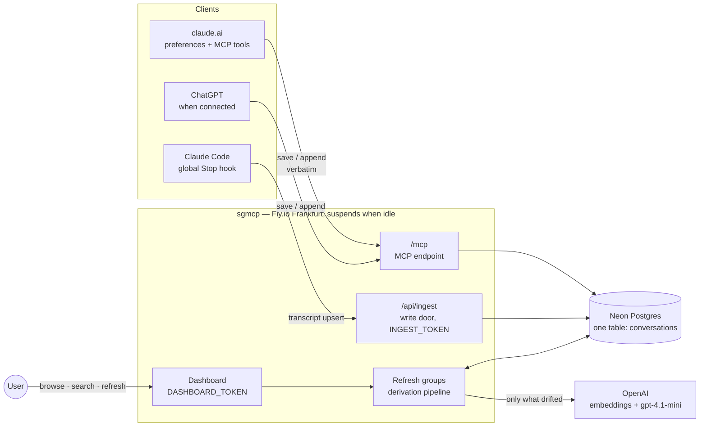
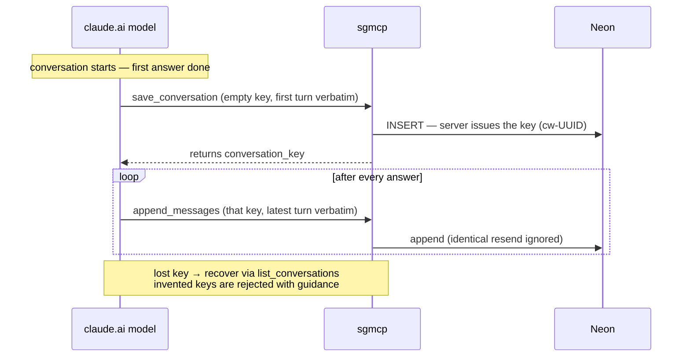
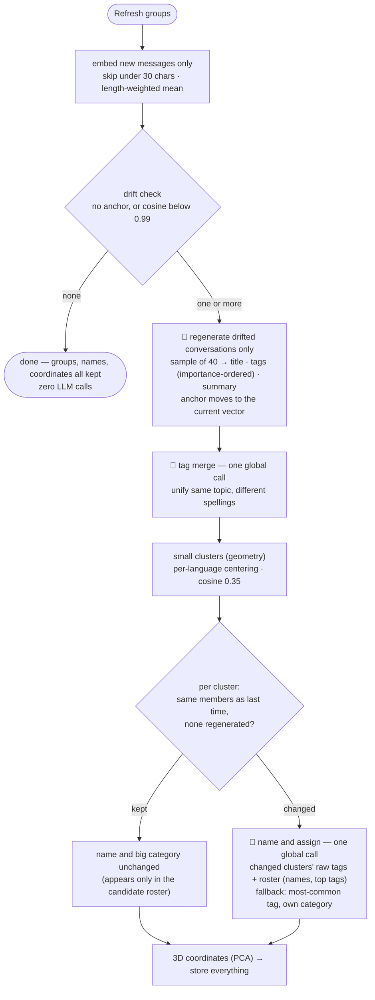

# sgmcp Architecture

A personal conversation archive: it collects conversations scattered across LLM
clients into one database, auto-derives titles, tags and summaries, and groups
them by topic.

## Architecture



One line per component:

| Component | Role |
|---|---|
| Clients | **pipes** — they push verbatim text under a key, nothing else. No judgment |
| Server (refresh) | all derivation — titles/tags/summaries, embeddings, groups, coordinates |
| Neon | the only store. Only `messages` is canonical; everything else is recomputable |
| OpenAI | embeddings (text-embedding-3-small), generation/naming (gpt-4.1-mini via pydantic-ai, schema + language guardrails with retry) |

## Save workflows

### claude.ai (per turn, driven by preferences)



### Claude Code (per turn, hook-driven — zero model tokens)

```mermaid
sequenceDiagram
    participant CC as Claude Code
    participant H as Stop hook (local script)
    participant S as sgmcp /api/ingest
    participant DB as Neon

    CC->>H: turn ends (transcript path on stdin)
    H->>H: extract conversation text from JSONL<br/>(tool output and internal logs dropped)
    H->>S: full upsert (cc-sessionUUID, token header)
    S->>DB: replace wholesale
    Note over H,DB: full-state upsert every turn = any failure<br/>heals on the next turn; 100% verbatim
```

## Refresh-groups workflow

The dashboard button is the only derivation trigger; save paths only store. 🤖 marks
an LLM call — with N drifted conversations a refresh makes **N + 2** calls, with
zero drift it makes **none**.



Sample = split the conversation into 20 segments, take the longest user and
assistant message from each (max 40 messages, 400 chars each).

## Data model — three layers of columns

| Layer | Columns | Written by |
|---|---|---|
| Canonical (immutable) | `conversation_key` `messages` `source` `project` | clients |
| Derived — LLM | `title` `tags` (importance-ordered array) `summary` `tagged_embedding` (anchor) | refresh, drift-gated |
| Derived — math | `embedding` (weighted mean) `embedded_*_count` `cluster_small/big(_label)` `px py pz` | refresh |

## Design principles

1. **The verbatim text is the only truth** — every derivative can be reset and
   recomputed (this happened several times during development)
2. **Store everything, filter only in derivation** — dropping data at save time is
   irreversible, so it is never done
3. **Clients are pipes** — all judgment (titles, tags, groups) lives on the server;
   reliance on model instruction-following is minimized
4. **Match the tool to the question** — "are these similar?" is math (geometry);
   "are these the same kind of thing, and what do we call it?" is an LLM's job
5. **Show only what the judgment needs** — originals for the decision subject,
   digests for context, nothing for the unaffected

## Tuned values and their evidence (measured)

| Value | Evidence |
|---|---|
| drift threshold cos 0.99 | last-10% growth ≈ 0.999 (skip) / doubling ≈ 0.983–0.989 (fire) / 25% foreign-topic inflow ≈ 0.980–0.995. A false fire costs one cheap call |
| length-weighted mean | equal weighting over-represents short frequent messages — real case: meta remarks were 37% of characters but took 53% of the vote and misplaced a conversation |
| per-language centering | before: similarity median 0.714 (one blob). After: same topic 0.4–0.9, different topics negative |
| big categories = LLM | "object detection and multi-agent are both AI" is classification knowledge, not geometry — the geometric version failed with 7 near-singletons |
| small-cluster threshold 0.35 | placed in the measured valley of the centered similarity distribution |
| `ARCHIVE_LANGUAGE` | all derived text in one configured language — keeps the tag vocabulary from splitting per language; enforced by an output validator with retry |

## Operations

- **Secrets** (Fly): `DATABASE_URL` `DASHBOARD_TOKEN` `INGEST_TOKEN` `OPENAI_API_KEY`;
  local `.env`: `INGEST_TOKEN` (for the hook)
- **Deploy**: `fly deploy --ha=false` — schema migrates automatically at startup
- **Cost**: Fly under $2 (suspend) + Neon $0 + OpenAI a few dozen cents per month
- **Full big-category rebuild** (one-off, when the structure grows stale):
  `UPDATE conversations SET cluster_small = NULL`, then refresh

## Known limitations / open items

- **`/mcp` is unauthenticated** — anyone with the URL can read stored conversations.
  The price of claude.ai connector compatibility; an unresolved security item
- claude.ai-side verbatim text can't be guaranteed (the model retypes it; the client
  offers no raw-transcript channel)
- A conversation mixing two topics lands between them — segmentation is deferred
  (it's a derivative, so it can be added retroactively)
- Unchanged groups never get re-assigned — use the full rebuild above when stale
- Conversations with only short messages (< 30 chars) have no embedding and don't
  appear in groups or on the map
