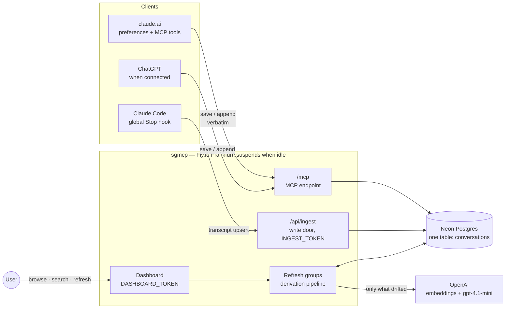
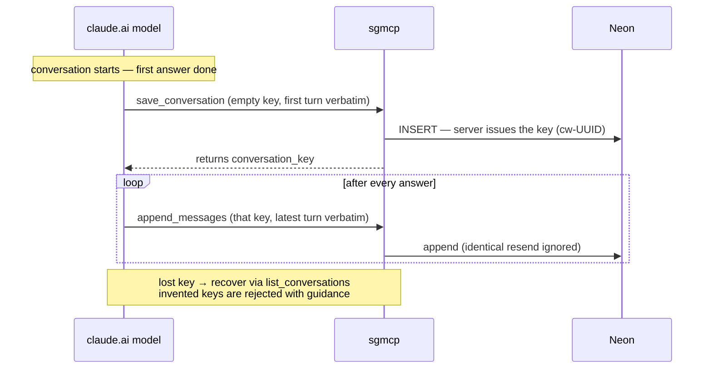
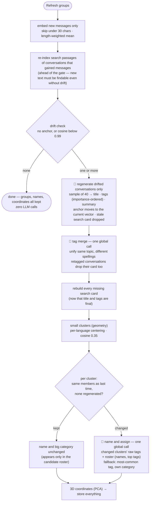

# sgmcp Architecture

A personal conversation archive: it collects conversations scattered across LLM
clients into one database, auto-derives titles, tags and summaries, and groups
them by topic.

## Architecture



One line per component:

| Component | Role |
|---|---|
| Clients | **pipes** — they push verbatim text under a key, nothing else. No judgment |
| Server (refresh) | all derivation — titles/tags/summaries, embeddings, groups, coordinates |
| Neon | the only store. Only `messages` is canonical; everything else is recomputable |
| OpenAI | embeddings (text-embedding-3-small), generation/naming (gpt-4.1-mini via pydantic-ai, schema + language guardrails with retry) |

## Save workflows

### claude.ai (per turn, driven by preferences)



### Claude Code (per turn, hook-driven — zero model tokens)

```mermaid
sequenceDiagram
    participant CC as Claude Code
    participant H as Stop hook (local script)
    participant S as sgmcp /api/ingest
    participant DB as Neon

    CC->>H: turn ends (transcript path on stdin)
    H->>H: extract conversation text from JSONL<br/>(tool output and internal logs dropped)
    H->>S: full upsert (cc-sessionUUID, token header)
    S->>DB: replace wholesale
    Note over H,DB: full-state upsert every turn = any failure<br/>heals on the next turn; 100% verbatim
```

## Refresh-groups workflow

The dashboard button is the only derivation trigger; save paths only store. 🤖 marks
an LLM call — with N drifted conversations a refresh makes **N + 2** calls, with
zero drift it makes **none**.



Sample = split the conversation into 20 segments, take the longest user and
assistant message from each (max 40 messages, 400 chars each).

## Search

Two modes share one box. **Text** matches literally (`ILIKE` over title, summary and
raw messages) and then ranks what is left by trigram `word_similarity` — right for an
exact string like an error message, a model name, or a query with a typo. **Meaning**
embeds the query and ranks by cosine distance, served by an HNSW index in pgvector.

Text search uses the `<%` operator, not `word_similarity(...) >= x`: only the operator
form can use the GIN trigram index, the function form always falls back to a scan (same
shape as `@>` vs `->>` for jsonb). Its cutoff comes from `pg_trgm.word_similarity_threshold`,
set per transaction. The ranking clause still calls the function — that runs on the rows
already selected, where no index applies.

Text search uses `word_similarity`, not `similarity`. `similarity()` divides by the
whole title's trigram count, so long titles score near zero — only 2 of 1065 measured
queries cleared the 0.3 default. `word_similarity` compares the query against the
best-matching *part* of the title instead: same queries averaged 0.651. Substring hits
still sort first so an exact term is never outranked by a fuzzy one; the trigram score
only orders the remainder and catches inflected forms (`임베딩을`) and misspellings
(`pgvecter`) that `ILIKE` misses outright.

Meaning-search deliberately does *not* use the conversation's average vector. An
average answers "what is this conversation about overall", which is what clustering
needs but too blurred to search: it also creates a hub conversation that wins
unrelated queries. Instead each conversation is cut into ~1500-character passages,
plus one card of `title + summary + tags`, and a conversation scores as its single
best-matching passage — "does this conversation contain what I'm asking about".

Passages are re-indexed when a conversation gains messages, ahead of the drift gate.
Cards follow a delete-and-rebuild rule: anything that changes their input text
(metadata regeneration, the tag merge) deletes the card row in the same transaction,
and a later pass rebuilds every missing card. A missing card is self-healing — the
next refresh notices and rebuilds it — whereas a silently stale one is not, because
the anchor has already moved and drift will never fire for it again.

## Data model — three layers of columns

| Layer | Columns | Written by |
|---|---|---|
| Canonical (immutable) | `conversation_key` `messages` `source` `project` | clients |
| Derived — LLM | `title` `tags` (importance-ordered array) `summary` `tagged_embedding` (anchor) | refresh, drift-gated |
| Derived — math | `embedding` (weighted mean) `embedding_vec` (same, pgvector-typed) `embedded_*_count` `cluster_small/big(_label)` `px py pz` | refresh |
| Search index | `conversation_chunks(conversation_id, kind, chunk_index, vec)` + `chunked_message_count` | refresh |

Drift is evaluated in SQL (`embedding <=> tagged_embedding`), so the metadata phase
never carries vectors in memory — they are loaded only for clustering and the 3D
projection.

## Design principles

1. **The verbatim text is the only truth** — every derivative can be reset and
   recomputed (this happened several times during development)
2. **Store everything, filter only in derivation** — dropping data at save time is
   irreversible, so it is never done
3. **Clients are pipes** — all judgment (titles, tags, groups) lives on the server;
   reliance on model instruction-following is minimized
4. **Match the tool to the question** — "are these similar?" is math (geometry);
   "are these the same kind of thing, and what do we call it?" is an LLM's job
5. **Show only what the judgment needs** — originals for the decision subject,
   digests for context, nothing for the unaffected

## Tuned values and their evidence (measured)

| Value | Evidence |
|---|---|
| drift threshold cos 0.99 | last-10% growth ≈ 0.999 (skip) / doubling ≈ 0.983–0.989 (fire) / 25% foreign-topic inflow ≈ 0.980–0.995. A false fire costs one cheap call |
| length-weighted mean | equal weighting over-represents short frequent messages — real case: meta remarks were 37% of characters but took 53% of the vote and misplaced a conversation |
| per-language centering | before: similarity median 0.714 (one blob). After: same topic 0.4–0.9, different topics negative |
| big categories = LLM | "object detection and multi-agent are both AI" is classification knowledge, not geometry — the geometric version failed with 7 near-singletons |
| small-cluster threshold 0.35 | placed in the measured valley of the centered similarity distribution |
| `ARCHIVE_LANGUAGE` | all derived text in one configured language — keeps the tag vocabulary from splitting per language; enforced by an output validator with retry |
| search passages of 1500 chars | 66 queries with known answers, top-1: conversation average 48%, per-message 59%, passages **68%** (live re-check 70%). Single messages lack context, whole conversations blur together. Passages also cost a fifth of per-message storage — 24 MB vs ~65 MB for this archive |
| `word_similarity` over `similarity` | 1065 keyword queries against known titles: `similarity` averaged 0.084 and only **2** cleared its 0.3 default; `word_similarity` averaged **0.651**. `similarity` divides by the whole title, so long titles score near zero |
| keyword floor 0.4 | below this the trigram score was noise rather than a weak match, measured on 25 paraphrased queries |
| `pg_trgm` over `pg_search` (BM25) | benchmarked locally on a copy of this archive. Exact-word queries (40, with particles): trigram and BM25+ngram both MRR **1.000**; BM25+korean_lindera 0.950. Paraphrased queries (25): BM25+lindera led on MRR (0.670 vs trigram 0.599) but trigram+vector RRF led on R@5 (**84%** vs 80%). `korean_lindera` also drops unknown loanwords to single characters (`임베딩` → 임/베/딩) and pg_search exposes no user-dictionary option, so its edge shrinks as new technical terms arrive. Not worth self-hosting Postgres — Neon deprecated `pg_search` |
| RRF only helps paraphrases | fusing keyword with vector raised R@5 from 76% to 84% on paraphrased queries, but *lowered* MRR from 1.000 to 0.715 on exact-word ones — the vector list drags in near-misses that push an exact hit down. Hence substring matches sort ahead of any score |

## Operations

- **Secrets** (Fly): `DATABASE_URL` `DASHBOARD_TOKEN` `INGEST_TOKEN` `OPENAI_API_KEY`;
  local `.env`: `INGEST_TOKEN` (for the hook)
- **Deploy**: `fly deploy --ha=false` — schema migrates automatically at startup
- **Cost**: Fly under $2 (suspend) + Neon $0 + OpenAI a few dozen cents per month
- **Full big-category rebuild** (one-off, when the structure grows stale):
  `UPDATE conversations SET cluster_small = NULL`, then refresh

## Known limitations / open items

- **`/mcp` is unauthenticated** — anyone with the URL can read stored conversations.
  The price of claude.ai connector compatibility; an unresolved security item
- claude.ai-side verbatim text can't be guaranteed (the model retypes it; the client
  offers no raw-transcript channel)
- A conversation mixing two topics lands between them — segmentation is deferred
  (it's a derivative, so it can be added retroactively)
- Unchanged groups never get re-assigned — use the full rebuild above when stale
- Conversations with only short messages (< 30 chars) have no embedding and don't
  appear in groups or on the map
- Meaning-search still misses roughly 3 in 10 first hits; most of those return a
  sibling conversation on the same topic rather than something unrelated
- `embedding_vec` is kept in sync but nothing reads it yet — it is the column a
  "conversations similar to this one" feature would use
- **Text search still needs `ILIKE` alongside the trigram operator, and that keeps the
  query on a seq scan.** `<%` only covers `title` and `summary` — body text is too long
  for word-similarity to mean anything — so `messages::text ILIKE` has to stay, and a
  single non-indexable branch in an `OR` chain drops the whole query to a scan
  (measured: 66 ms over 46 rows, `Seq Scan`, all three trigram indexes ignored). The
  expression index on `messages::text` does work when forced (`enable_seqscan=off` →
  `Bitmap Heap Scan`); the planner just prefers a scan at this size. Whether it flips
  on its own as the archive grows is untested.

  **What `pg_search` would buy** — not better results, but a simpler shape. Measured
  quality was a wash (see the evidence table): identical MRR on exact-word queries,
  trigram+vector RRF actually ahead on paraphrases. The gain is structural:

  | | now | with BM25 |
  |---|---|---|
  | where clause | 5 branches (3 ILIKE + 2 `<%`) | 1 (`@@@`) |
  | order by | 3 tiers, hand-tuned | `paradedb.score()` |
  | indexes for text | 3 trigram GIN | 1 BM25 |
  | body search | ILIKE only, forces seq scan | same index as title |
  | index actually used | no, at this size | yes |
  | field weighting, phrase search | none | built in |

  Blocked by Neon (`neon.deprecated_extensions = pg_search, plv8`), so it means either
  ParadeDB Cloud or self-hosting Postgres — backups, failover and upgrades become ours.
  At 46 conversations / 15 MB that trade is not worth it. **Revisit when text search is
  a primary path rather than a fallback, or when the seq scan shows up in practice.**
  The benchmark is reproducible: `docker run paradedb/paradedb`, `pg_dump -t conversations`,
  then the two eval sets (40 title-word queries with particles, 25 paraphrases with known
  answers) scored by MRR and R@5.
