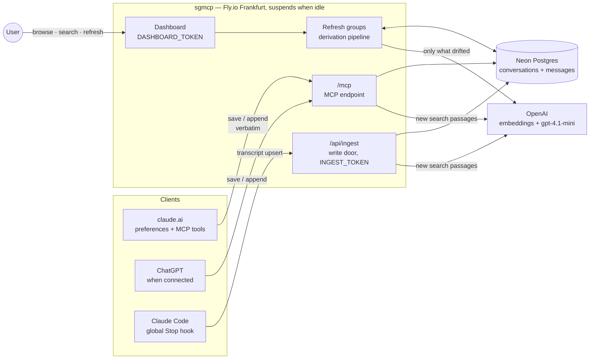
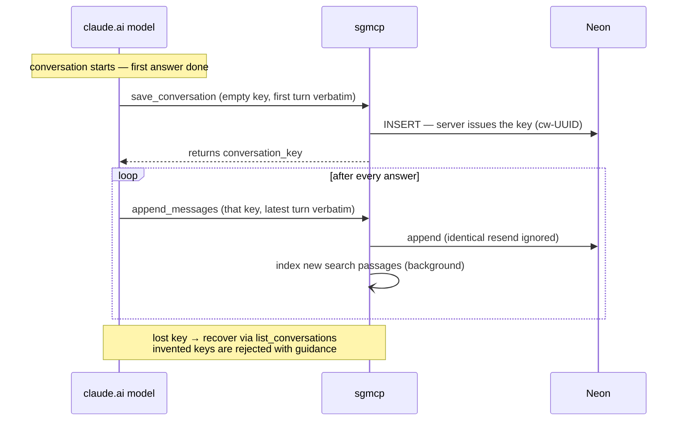
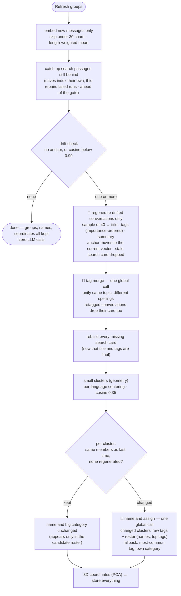

# sgmcp Architecture

A personal conversation archive: it collects conversations scattered across LLM
clients into one database, auto-derives titles, tags and summaries, and groups
them by topic.

## Architecture



One line per component:

| Component | Role |
|---|---|
| Clients | **pipes** — they push verbatim text under a key, nothing else. No judgment |
| Server | after each save: index that conversation's new search passages, in the background. On refresh: all other derivation — titles/tags/summaries, embeddings, groups, coordinates |
| Neon | the only store. Only the `messages` table is canonical; everything else is recomputable |
| OpenAI | embeddings (text-embedding-3-small), generation/naming (gpt-4.1-mini via pydantic-ai, schema + language guardrails with retry) |

## Save workflows

### claude.ai (per turn, driven by preferences)



### Claude Code (per turn, hook-driven — zero model tokens)

```mermaid
sequenceDiagram
    participant CC as Claude Code
    participant H as Stop hook (local script)
    participant S as sgmcp /api/ingest
    participant DB as Neon

    CC->>H: turn ends (transcript path on stdin)
    H->>H: extract conversation text from JSONL<br/>(tool output, internal logs and API error notices dropped)
    H->>S: full upsert (cc-sessionUUID, token header)
    S->>DB: insert the new tail<br/>(rewrite all if the last 20 stored differ)
    S-)S: index new search passages (background)
    Note over H,DB: full-state upsert every turn = any failure<br/>heals on the next turn; 100% verbatim
```

## Refresh-groups workflow

Apart from search passages, which every save indexes on its own (see Search), the
dashboard button is the only derivation trigger. 🤖 marks
an LLM call — with N drifted conversations a refresh makes **N + 2** calls, with
zero drift it makes **none**.



Sample = split the conversation into 20 segments, take the longest user and
assistant message from each (max 40 messages, 400 chars each).

## Search

Two modes share one box. **Text** is literal (`ILIKE` over title, summary and raw
messages) — right for an exact string like an error message. **Meaning** embeds the
query and ranks by cosine distance, served by an HNSW index in pgvector. Assistants
get the same two modes as MCP tools, `search_conversations` and
`search_conversations_by_meaning`.

Meaning-search deliberately does *not* use the conversation's average vector. An
average answers "what is this conversation about overall", which is what clustering
needs but too blurred to search: it also creates a hub conversation that wins
unrelated queries. Instead each conversation is cut into ~1500-character passages,
plus one card of `title + summary + tags`, and a conversation scores as its single
best-matching passage — "does this conversation contain what I'm asking about".

Passages are indexed right after every save. The save tools and `/api/ingest` queue
the conversation on a single background worker, so a save never waits on OpenAI and
saves never index the same conversation twice at once. Passages are cut in message
order, so appended messages can only change the last passage and add new ones; only
those are embedded — one passage per turn, where rebuilding the largest conversation
from scratch takes about a thousand. Embedding runs outside any lock, so before writing, the job
locks the row and checks that `chunked_message_count` is still the value it started
from; if a refresh got there first, it writes nothing. A failed run leaves the counter
behind, so the next save or the refresh's catch-up step finishes the job. A
conversation that shrank was rewritten, and starts over.

Passages are a hard cut every 1,500 characters of the conversation's text (moved
back to a space within 100 characters, so words stay whole), not aligned to
messages: sizes stay even and a long message is split rather than truncated. The
earlier message-aligned rule glued whole messages past 1,500 characters and capped a
passage at 6,000, which left 11% of the text unsearchable. Each passage is embedded
together with the 200 characters before it, while its positions still cover only the
messages of its own text: a sentence or a question/answer pair straddling a cut then
scores as a whole instead of as two weak halves. The cutting rule carries a version (`CHUNK_VERSION`, stored per
conversation as `chunk_version`); a conversation cut under another version is re-cut
from scratch on its next indexing, so old and new passages never mix — changing the
rule means bumping the number, and a save or refresh does the rest.

Cards follow a delete-and-rebuild rule: anything that changes their input text
(metadata regeneration, the tag merge) deletes the card row in the same transaction,
and a later pass rebuilds every missing card. A missing card is self-healing — the
next refresh notices and rebuilds it — whereas a silently stale one is not, because
the anchor has already moved and drift will never fire for it again.

Results point inside the conversation. Each passage stores the first and last
message it covers, so a meaning-search result groups its best passages (within 0.15
of its best score, at most 10 passages apart) into `sections`: message ranges with
the best message and an excerpt. Keyword results do the same with the messages that
contain the word (hits at most 20 messages apart form a section; newest first, older
ones still listed). `get_conversation` then reads one page from `start`, or backwards
from the newest message: the database adds messages until their text reaches 20,000
characters, inside Claude Code's tool-output limit, so a conversation under that size
comes back whole (a single longer message is cut and flagged `truncated`). A
section's length is what tells an assistant whether the topic was a passing remark
or a long discussion worth paging through. Every search and read made through MCP
lands in `recall_log`, the way to check whether assistants follow a section through
or stop at the first window.

Messages carry the time they were sent (`at`): the transcript's timestamp for Claude
Code, the moment the save arrived for claude.ai (so a turn's messages share it). A
rewrite keeps the time of every message that survives it in place. Sections report
when their first and last message were sent (`start_at`, `end_at`), which is what
lets "what did we do last night" land on the right stretch. Messages saved before
times were recorded have none, unless their Claude Code transcript was still on disk
to fill them from — Claude Code deletes transcripts after `cleanupPeriodDays`.

## Data model — three layers of columns

| Layer | Columns | Written by |
|---|---|---|
| Canonical (immutable) | `conversation_key` `source` `project`, and `messages(conversation_id, idx, role, content, at)` — one row per message, `message_count` on the conversation | clients |
| Derived — LLM | `title` `tags` (importance-ordered array) `summary` `tagged_embedding` (anchor) | refresh, drift-gated |
| Derived — math | `embedding` (weighted mean) `embedding_vec` (same, pgvector-typed) `embedded_*_count` `cluster_small/big(_label)` `px py pz` | refresh |
| Search index | `conversation_chunks(conversation_id, kind, chunk_index, vec, first_message, last_message)` + `chunked_message_count` `chunk_version` | each save (body passages, background) · refresh (cards, catch-up) |
| Usage log | `recall_log(tool, args, result)` — a separate table | the MCP search and read tools |

Drift is evaluated in SQL (`embedding <=> tagged_embedding`), so the metadata phase
never carries vectors in memory — they are loaded only for clustering and the 3D
projection.

## Design principles

1. **The verbatim text is the only truth** — every derivative can be reset and
   recomputed (this happened several times during development)
2. **Store everything, filter only in derivation** — dropping data at save time is
   irreversible, so it is never done
3. **Clients are pipes** — all judgment (titles, tags, groups) lives on the server;
   reliance on model instruction-following is minimized
4. **Match the tool to the question** — "are these similar?" is math (geometry);
   "are these the same kind of thing, and what do we call it?" is an LLM's job
5. **Show only what the judgment needs** — originals for the decision subject,
   digests for context, nothing for the unaffected

## Tuned values and their evidence (measured)

| Value | Evidence |
|---|---|
| drift threshold cos 0.99 | last-10% growth ≈ 0.999 (skip) / doubling ≈ 0.983–0.989 (fire) / 25% foreign-topic inflow ≈ 0.980–0.995. A false fire costs one cheap call |
| length-weighted mean | equal weighting over-represents short frequent messages — real case: meta remarks were 37% of characters but took 53% of the vote and misplaced a conversation |
| per-language centering | before: similarity median 0.714 (one blob). After: same topic 0.4–0.9, different topics negative |
| big categories = LLM | "object detection and multi-agent are both AI" is classification knowledge, not geometry — the geometric version failed with 7 near-singletons |
| small-cluster threshold 0.35 | placed in the measured valley of the centered similarity distribution |
| `ARCHIVE_LANGUAGE` | all derived text in one configured language — keeps the tag vocabulary from splitting per language; enforced by an output validator with retry |
| search passages of 1500 chars | 66 queries with known answers, top-1: conversation average 48%, per-message 59%, passages **68%** (live re-check 70%). Single messages lack context, whole conversations blur together. Passages also cost a fifth of per-message storage — 24 MB vs ~65 MB for this archive |

## Operations

- **Secrets** (Fly): `DATABASE_URL` `DASHBOARD_TOKEN` `INGEST_TOKEN` `OPENAI_API_KEY`;
  local `.env`: `INGEST_TOKEN` (for the hook)
- **Deploy**: `fly deploy --ha=false` — schema migrates automatically at startup
- **Cost**: Fly under $2 (suspend) + Neon $0 + OpenAI a few dozen cents per month
- **Full big-category rebuild** (one-off, when the structure grows stale):
  `UPDATE conversations SET cluster_small = NULL`, then refresh

## Known limitations / open items

- **`/mcp` is unauthenticated** — anyone with the URL can read stored conversations.
  The price of claude.ai connector compatibility; an unresolved security item
- claude.ai-side verbatim text can't be guaranteed (the model retypes it; the client
  offers no raw-transcript channel)
- A conversation mixing two topics lands between them — segmentation is deferred
  (it's a derivative, so it can be added retroactively)
- Unchanged groups never get re-assigned — use the full rebuild above when stale
- Conversations with only short messages (< 30 chars) have no embedding and don't
  appear in groups or on the map
- Meaning-search still misses roughly 3 in 10 first hits; most of those return a
  sibling conversation on the same topic rather than something unrelated
- `embedding_vec` is kept in sync but nothing reads it yet — it is the column a
  "conversations similar to this one" feature would use
