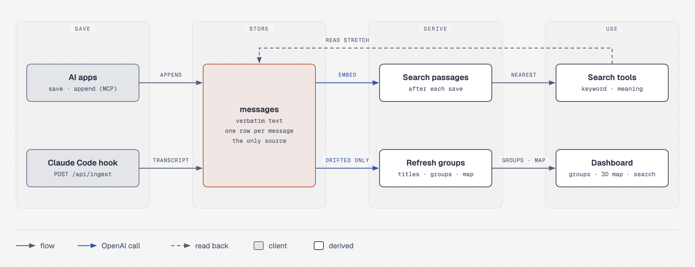
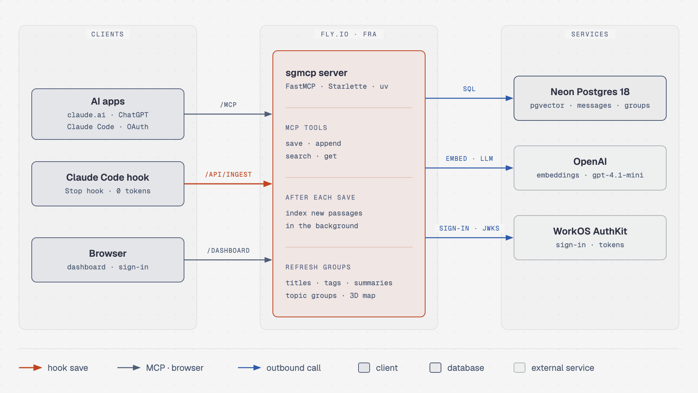
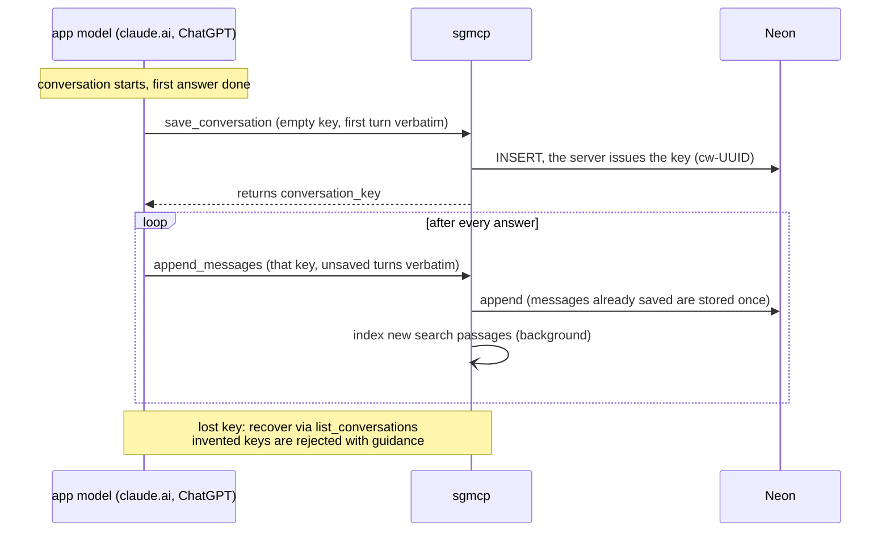
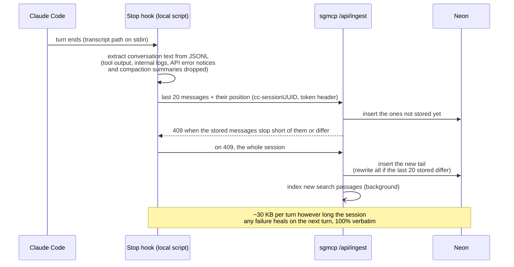
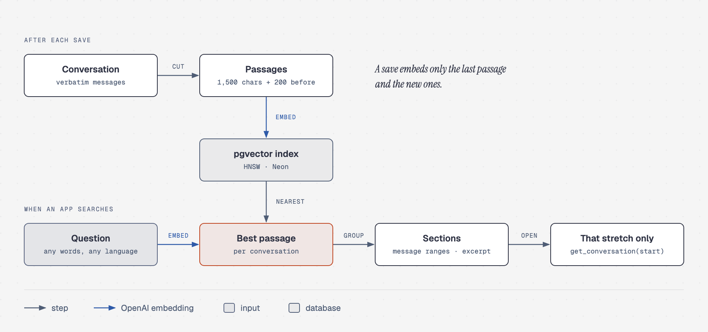
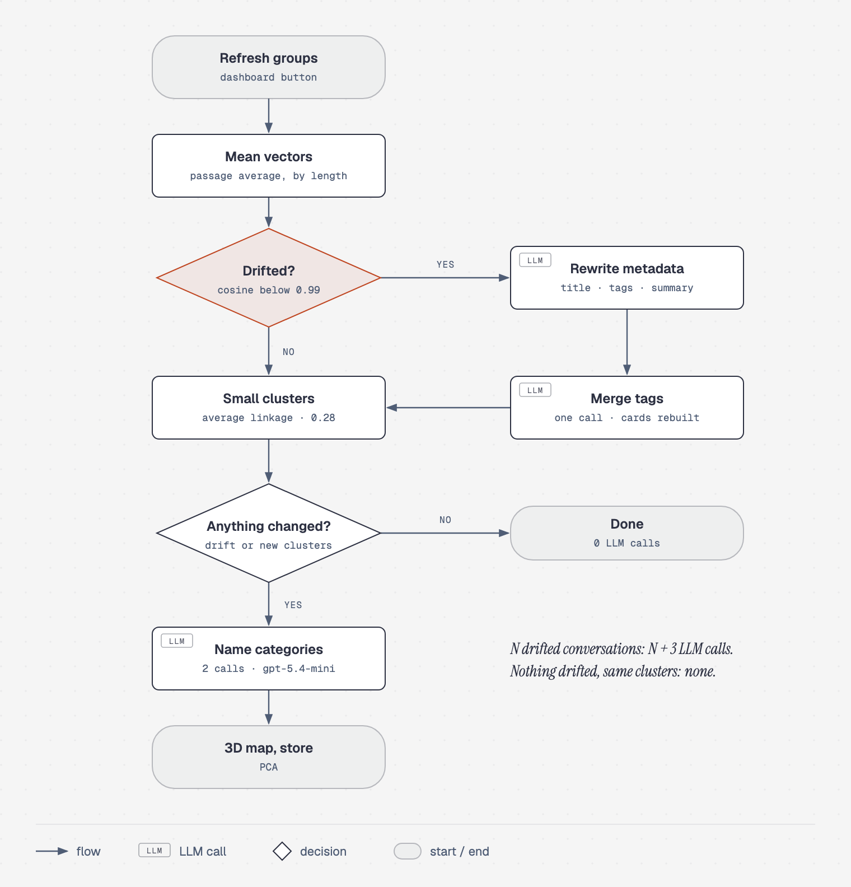
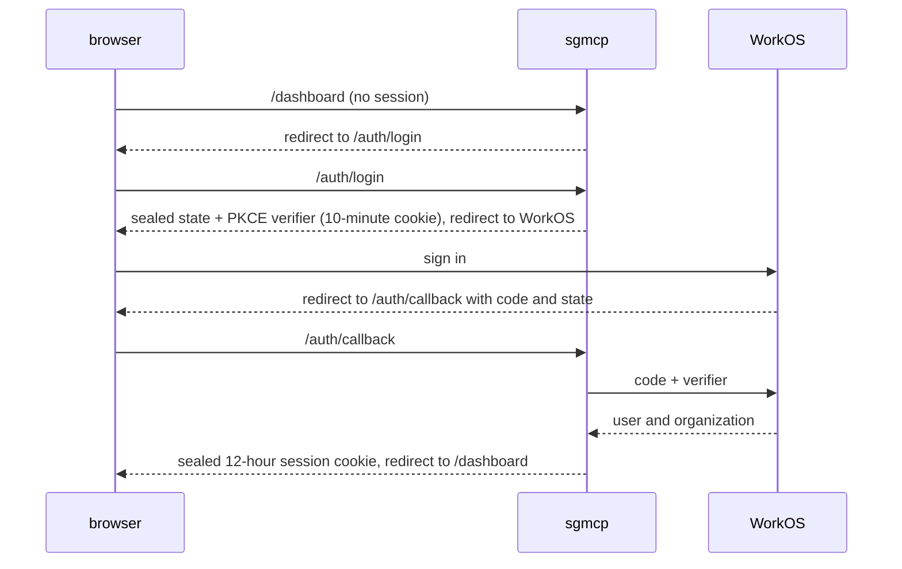

[English](ARCHITECTURE.md) | [한국어](docs/ko/ARCHITECTURE.md)

# sgmcp architecture

sgmcp collects conversations from several AI apps into one Postgres archive, derives titles, tags, summaries and topic groups from them, and serves them back to any app through search.

| Stage | What happens | Details |
|---|---|---|
| Save | Apps push conversation text exactly as written: claude.ai and ChatGPT through MCP tools, Claude Code through a Stop hook | [Saving](#saving) |
| Store | One row per message in Postgres, the only data that can't be rebuilt | [Storage](#storage) |
| Derive | Each save indexes the conversation's new search passages. The Refresh groups button writes titles, tags, summaries, groups and the 3D map, for what changed only | [Search index](#search-index), [Refresh groups](#refresh-groups) |
| Use | Search tools return the stretches where a topic sits, and `get_conversation` reads them. The dashboard shows the groups and the map | [Search](#search) |

## Components

| Component | Role |
|---|---|
| Clients | Pipes. They push verbatim text under a key and make no judgment |
| Server | After each save, indexes that conversation's new search passages in the background. On refresh, all other derivation: titles, tags, summaries, groups, coordinates |
| Neon | The only store. Only the messages are canonical; everything else can be recomputed |
| OpenAI | Embeddings (`text-embedding-3-small`). Through pydantic-ai, titles, tags and summaries (`gpt-4.1-mini`) and group names (`gpt-5.4-mini`), with schema and language checks that retry on failure |
| WorkOS | Sign-in for `/mcp` and the dashboard. Membership in one organization is the approval |

| Path | Used by | Auth |
|---|---|---|
| `/mcp` | AI apps | WorkOS OAuth access token |
| `/api/ingest` | Claude Code hook | `INGEST_TOKEN` |
| `/dashboard`, `/api/*` | browser | WorkOS sign-in, 12-hour session cookie |
| `/auth/login`, `/auth/callback` | browser | the sign-in itself |

## Saving

### claude.ai and ChatGPT: per turn, asked for by instructions
The app's model calls the save tools because its standing instructions ask it to ([Setup § Auto-save](docs/en/setup.md#auto-save)).

The model retypes the text it sends, so this path can't guarantee verbatim text; the apps offer no raw-transcript channel.

### Claude Code: per turn, from a hook, no model tokens

## Storage

### Data model: three layers of columns
| Layer | Columns | Written by |
|---|---|---|
| Canonical (immutable) | `conversation_key` `source` `project`, and `messages(conversation_id, idx, role, content, at)`: one row per message, `message_count` on the conversation | clients |
| Derived, LLM | `title` `tags` (importance-ordered array) `summary` `tagged_embedding` (anchor) | refresh, only for conversations that drifted |
| Derived, math | `embedding` (passage mean, length-weighted) `embedded_message_count` `cluster_small/big(_label)` `px py pz` | refresh |
| Search index | `conversation_chunks(conversation_id, kind, chunk_index, vec, first_message, last_message)` + `chunked_message_count` `chunk_version` | each save (body passages, background) · refresh (cards, catch-up) |
| Usage log | `recall_log(tool, args, result)`, a separate table | the MCP search and read tools |

Drift is evaluated in SQL (`embedding <=> tagged_embedding`), so the metadata phase never carries vectors in memory. They are loaded only for clustering and the 3D projection.

### Message times
Messages carry the time they were sent (`at`): the transcript's timestamp for Claude Code, the moment the save arrived for claude.ai and ChatGPT (so a turn's messages share it). A rewrite keeps the time of every message that survives it in place. Messages saved before times were recorded have none, unless their Claude Code transcript was still on disk to fill them from; Claude Code deletes transcripts after `cleanupPeriodDays`.

## Search index

Each conversation is cut into passages of about 1,500 characters, plus one card of `title + summary + tags`. Search scores a conversation by its single best-matching passage. A conversation's average vector says what it is about overall, which clustering needs but which is too blurred for search: on 66 queries it put the right conversation first 48% of the time against 68% for passages, and one hub conversation won unrelated queries ([Evaluating search and grouping](docs/en/eval.md#what-the-measurements-decided)).

**Indexing after every save.** The save tools and `/api/ingest` queue the conversation on a single background worker, so a save never waits on OpenAI and two saves never index the same conversation at once. Passages are cut in message order, so appended messages can only change the last passage and add new ones; only those are embedded. That is one passage per turn, where rebuilding the largest conversation from scratch takes about a thousand. Embedding runs outside any lock, so before writing, the job locks the row and checks that `chunked_message_count` is still the value it started from; if a refresh got there first, it writes nothing. A failed run leaves the counter behind, so the next save or the refresh's catch-up step finishes the job. A conversation that shrank was rewritten, and starts over.

**The cutting rule.** Passages are a hard cut every 1,500 characters of the conversation's text, moved back to a space within 100 characters so words stay whole. They are not aligned to messages: sizes stay even, and a long message is split rather than truncated. The earlier message-aligned rule glued whole messages past 1,500 characters and capped a passage at 6,000, which left 11% of the text unsearchable. Each passage is embedded together with the 200 characters before it, while its positions still cover only the messages of its own text, so a sentence or a question and answer straddling a cut scores as a whole instead of as two weak halves. The rule carries a version (`CHUNK_VERSION`, stored per conversation as `chunk_version`). A conversation cut under another version is re-cut from scratch on its next indexing, so old and new passages never mix: changing the rule means bumping the number, and a save or refresh does the rest.

**Cards: delete and rebuild.** Anything that changes a card's input text (metadata regeneration, the tag merge) deletes the card row in the same transaction, and a later pass rebuilds every missing card. A missing card heals itself, because the next refresh notices it. A silently stale one would not, because the anchor has already moved and drift will never fire for it again.

## Search
Two modes share one search box on the dashboard, and the apps get the same two as MCP tools.

| Mode | Tool | How |
|---|---|---|
| Text | `search_conversations` | `ILIKE` over title, summary and raw messages, matching the query's `%`, `_` and `\` as plain characters. Right for an exact string such as an error message. Trigram indexes on title and summary skip a full scan |
| Meaning | `search_conversations_by_meaning` | embeds the query and ranks conversations by their best passage's cosine distance, through an HNSW index in pgvector |

**Results point inside the conversation.** Each passage stores the first and last message it covers, so a meaning-search result groups its best passages (within 0.15 of its best score, at most 10 passages apart) into `sections`: message ranges with the best message and an excerpt. Keyword results do the same with the messages that contain the word: hits at most 20 messages apart form a section, newest first, older ones still listed. Sections report when their first and last message were sent (`start_at`, `end_at`), which is what lets "what did we do last night" land on the right stretch. A section's length tells an assistant whether the topic was a passing remark or a long discussion worth paging through.

**Reading.** `get_conversation` reads one page from `start`, or backwards from the newest message. The database adds messages until their text reaches 20,000 characters, inside Claude Code's tool-output limit, so a conversation under that size comes back whole; a single longer message is cut and flagged `truncated`.

Every search and read made through MCP lands in `recall_log`, the way to check whether assistants follow a section through or stop at the first window.

## Refresh groups
Apart from search passages, which every save indexes on its own, the dashboard button is the only derivation trigger. With N drifted conversations a refresh makes **N + 3** LLM calls; with no drift and the same clusters as last time it makes **none**.

Steps 4 to 6 run only when at least one conversation drifted.

| Step | What happens | LLM calls |
|---|---|---|
| 1. Catch up | Index search passages still behind. Saves index their own; this repairs failed runs, before the drift check | 0 |
| 2. Mean vectors | Each conversation's vector is its passages' average, weighted by their own length. No embedding calls; conversations whose passages didn't move are skipped | 0 |
| 3. Drift check | A conversation drifted when it has no anchor yet, or its vector's cosine to the anchor is below 0.99 | 0 |
| 4. Rewrite metadata | For drifted conversations only, a sample of 40 messages gives a new title, tags (importance-ordered) and summary. The anchor moves to the current vector, and the stale search card is dropped | 1 per drifted conversation |
| 5. Merge tags | One call over all tags unifies different spellings of the same topic. Retagged conversations drop their card too | 1 |
| 6. Rebuild cards | Every missing search card is rebuilt, now that titles and tags are final | 0 (embeddings only) |
| 7. Small clusters | Geometry, on every refresh: passage mean + card, per-language centering, average linkage at cosine 0.28 | 0 |
| 8. Name the tree | Only when something drifted or the clusters differ from the stored ones. `gpt-5.4-mini` invents about 5 to 15 big categories, each with what it holds (a target, not checked), then places every group into one (a closed choice) and names it. A failure stores nothing, so the next refresh retries | 2 |
| 9. 3D map | Coordinates by PCA, then everything is stored | 0 |

The sample: split the conversation into 20 segments and take the longest user and assistant message from each, at most 40 messages of 400 characters each.

## Sign-in

| Door | Check |
|---|---|
| `/mcp` | A WorkOS AuthKit access token (JWT): RS256 signature from the JWKS, `iss` = `MCP_AUTH_ISSUER`, `aud` = `<PUBLIC_URL>/mcp`, `exp` required, `org_id` = `MCP_AUTH_ORG`. A missing or rejected token gets 401 with the protected-resource metadata, which starts the app's OAuth sign-in. A bearer value that isn't a JWT (the hook's token) is skipped without a log line. Without `MCP_AUTH_ISSUER`, `/mcp` is open, for local development |
| `/api/ingest` | `Authorization: Bearer <INGEST_TOKEN>`, compared in constant time; 403 otherwise |
| dashboard | OAuth authorization code with PKCE through WorkOS, as above. The callback checks the state against the sealed cookie and the user's organization against `MCP_AUTH_ORG`. The session cookie is HttpOnly, SameSite=Lax and Secure over https; `/api/*` answers 403 without it |

## Design principles
1. **The verbatim text is the only truth.** Every derivative can be reset and recomputed (this happened several times during development).
2. **Store everything, filter only in derivation.** Dropping data at save time is irreversible, so it is never done.
3. **Clients are pipes.** All judgment (titles, tags, groups) lives on the server, and reliance on a model following instructions is kept small.
4. **Match the tool to the question.** "Are these similar?" is math (geometry); "are these the same kind of thing, and what do we call it?" is an LLM's job.
5. **Show only what the judgment needs.** Originals for the decision subject, digests for context, nothing for the unaffected.

## Tuned values and their evidence (measured)
How the search and grouping evals work, and the measurements in more detail: [Evaluating search and grouping](docs/en/eval.md).

| Value | Evidence |
|---|---|
| drift threshold cos 0.99 | last-10% growth ≈ 0.999 (skip) / doubling ≈ 0.983–0.989 (fire) / 25% foreign-topic inflow ≈ 0.980–0.995. A false fire costs one cheap call |
| length-weighted mean | equal weighting over-represents short frequent messages. Real case: meta remarks were 37% of characters but took 53% of the vote and misplaced a conversation |
| per-language centering | before: similarity median 0.714 (one blob). After: same topic 0.4–0.9, different topics negative |
| big categories = LLM | "object detection and multi-agent are both AI" is classification knowledge, not geometry. The geometric version failed with 7 near-singletons |
| small clusters: average linkage on mean + card, 0.28 | 87 conversations scored against the pairs two LLM filings agreed on (155 together, the rest apart): F1 0.62, precision 0.78, flat at 0.58–0.62 from 0.22 to 0.32. The previous centroid linkage on the mean alone scored 0.37: a growing cluster's blurred centre absorbed its neighbours into a 16-member blob |
| tree named in two calls, `gpt-5.4-mini` | one call inventing categories and assigning groups at once filed software projects under job hunting. Two calls (categories with scopes, then a closed choice) on 36 groups misfiled ~6 with 4.1-mini, ~5 with 5.4-mini, ~3 with 5.5, at $0.01 / $0.02 / $0.18 a regroup |
| `ARCHIVE_LANGUAGE` | all derived text in one configured language keeps the tag vocabulary from splitting per language; an output validator with retry enforces it |
| search passages of 1500 chars | 66 queries with known answers, top-1: conversation average 48%, per-message 59%, passages **68%** (live re-check 70%). Single messages lack context, whole conversations blur together. Passage vectors take 24 MB against ~65 MB per message for this archive |

## Operations
- **Secrets** (Fly): `DATABASE_URL` `INGEST_TOKEN` `OPENAI_API_KEY` `PUBLIC_URL` `MCP_AUTH_ISSUER` `MCP_AUTH_ORG` `WORKOS_CLIENT_ID` `WORKOS_API_KEY` `WORKOS_COOKIE_PASSWORD`; local `.env`: `INGEST_TOKEN` (for the hook)
- **Deploy**: `fly deploy --ha=false`
- **Schema**: the statements in `db._SCHEMA` run on a process's first database connection. Each one that ran is recorded in `schema_migrations` and skipped from then on, because `ALTER TABLE ... IF NOT EXISTS` locks the whole table even when there is nothing to add, and a start would otherwise queue behind any long write
- **Cost**: Fly under $2 (suspended when idle) + Neon $0 + OpenAI a few dozen cents a month

## Known limitations
- **Access is all or nothing.** `/mcp` and the dashboard let in only members of one WorkOS organization, and each member sees the whole archive: conversations have no owner yet. A dashboard sign-in lasts 12 hours, so removing a member takes up to that long
- Verbatim text from claude.ai and ChatGPT can't be guaranteed: the model retypes it, and the apps offer no raw-transcript channel
- A conversation mixing two topics lands between them. Splitting is deferred; it is a derivative, so it can be added later
- Unchanged groups never get re-assigned. Use the full rebuild when they go stale
- Conversations with only short messages (< 30 chars) have no embedding and don't appear in groups or on the map
- Meaning search puts the right conversation first for 83% of the eval questions, and in the top 3 for 96%. For a topic that isn't in the archive it still returns a confident-looking result: 3 of 10 such questions pass ([current results](docs/en/eval.md#current-results))
