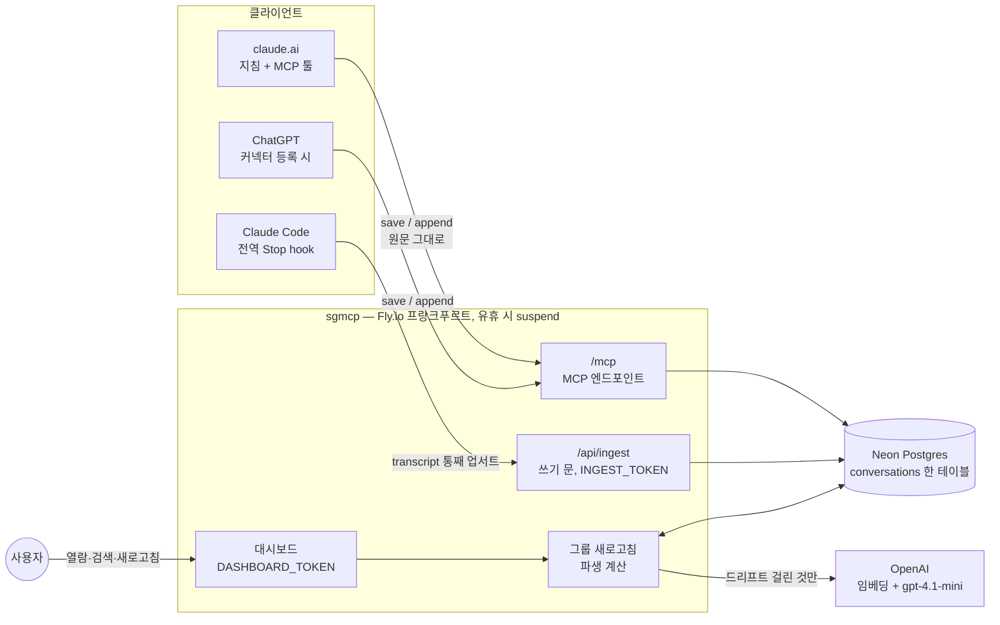
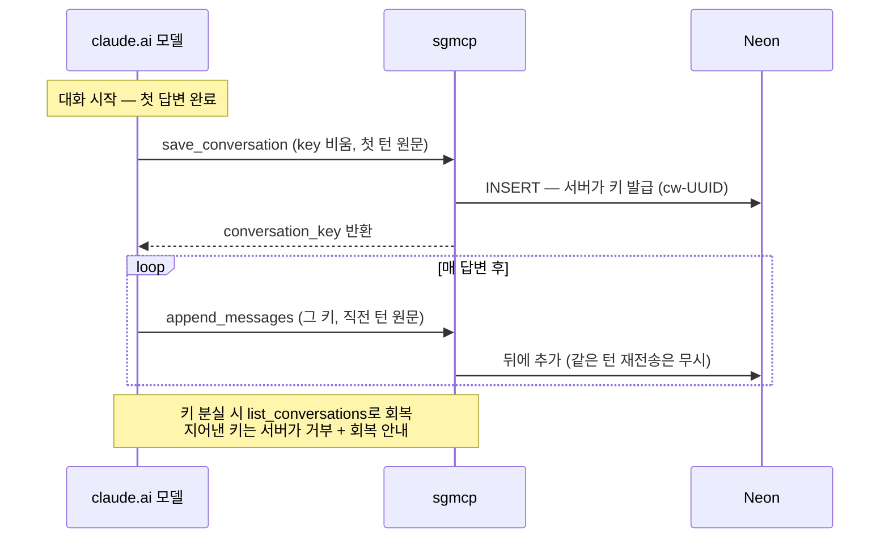
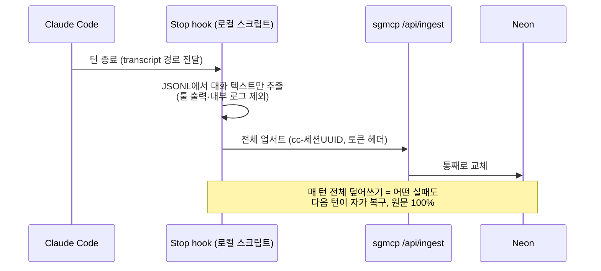
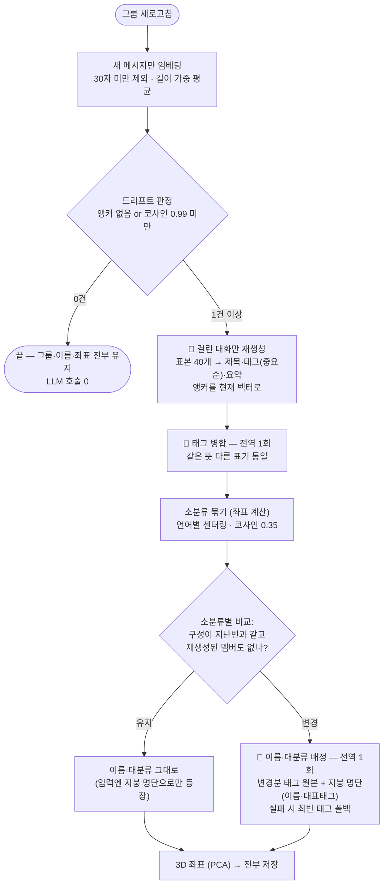

# sgmcp 아키텍처

여러 LLM 클라이언트에 흩어진 대화를 한 DB에 모으고, 자동으로 제목·태그·요약을 달아
주제별로 그룹화해 보여주는 개인용 대화 아카이브.

## 전체 아키텍처

역할 분담 한 줄씩:

| 구성요소 | 역할 |
|---|---|
| 클라이언트 | **파이프** — 원문을 키에 실어 보내는 것이 전부. 판단 없음 |
| 서버 (새로고침) | 모든 파생 — 제목·태그·요약, 임베딩, 그룹, 좌표 |
| Neon | 유일한 저장소. `messages` 원문만 canonical, 나머지는 재계산 가능한 파생물 |
| OpenAI | 임베딩(text-embedding-3-small), 생성·이름(gpt-4.1-mini) |

## 저장 워크플로

### claude.ai (매 턴, 지침 기반)

### Claude Code (매 턴, hook 기반 — 모델·토큰 개입 0)

## 그룹 새로고침 워크플로

대시보드 버튼이 유일한 파생 트리거. 저장 경로는 저장만 한다. 🤖 = LLM(mini) 호출 —
드리프트 N건 발생 시 총 **N + 2회**, 0건이면 **0회**.

표본 = 대화를 20구간으로 나눠 구간마다 user·assistant 최장 1개씩 (최대 40개, 각 400자).

## 데이터 모델 — 컬럼 3층

| 층 | 컬럼 | 쓰는 주체 |
|---|---|---|
| 원본 (불변) | `conversation_key` `messages` `source` `project` | 클라이언트 |
| 파생 — LLM | `title` `tags`(중요순 배열) `summary` `tagged_embedding`(앵커) | 새로고침, 드리프트 게이트 |
| 파생 — 수학 | `embedding`(가중 평균) `embedded_*_count` `cluster_small/big(_label)` `px py pz` | 새로고침 |

## 설계 원칙

1. **원문이 유일한 진실** — 파생물은 전부 리셋·재계산 가능 (개발 중 실제로 여러 번 갈아탐)
2. **저장은 전부, 파생은 선별** — 거르기는 계산에서만, 저장에서 버리면 비가역
3. **클라이언트는 파이프** — 판단(제목·태그·그룹)은 전부 서버. 모델 지침 의존 최소화
4. **일의 성격에 맞는 도구** — "비슷한가"는 수학(좌표), "같은 카테고리인가·이름은"은 LLM
5. **판단이 필요한 만큼만 보여준다** — 판단 대상은 원본, 참고 대상은 요약, 무관한 건 생략

## 정해진 값들과 근거 (실측 기반)

| 값 | 근거 |
|---|---|
| 드리프트 임계 코사인 0.99 | 마지막 10% 성장 ≈ 0.999(스킵) / 2배 성장 ≈ 0.983~0.989(발동) / 타주제 25% 유입 ≈ 0.980~0.995. 오발동 비용이 싸서 민감하게 |
| 길이 가중 평균 | 동일 가중은 짧고 잦은 메시지가 과대 대표 — 실사례: 메타 멘트가 글자수 37%인데 표 53%를 먹어 오분류 |
| 언어별 센터링 | 보정 전 유사도 중앙값 0.714 (전부 한 덩어리) → 보정 후 같은 주제 0.4~0.9, 다른 주제 음수 |
| 대분류 = LLM 배정 | "객체인식과 멀티에이전트는 둘 다 AI"는 좌표가 아니라 분류 상식 — 좌표식은 낱개 7개로 실패 |
| 소분류 임계 0.35 | 센터링 후 실측 분포의 골짜기에 배치 |

## 운영

- **시크릿** (Fly): `DATABASE_URL` `DASHBOARD_TOKEN` `INGEST_TOKEN` `OPENAI_API_KEY` / 로컬 `.env`: `INGEST_TOKEN`(hook용)
- **배포**: `fly deploy --ha=false` — 스키마는 시작 시 자동 마이그레이션
- **비용**: Fly $2 미만(suspend) + Neon $0 + OpenAI 월 몇십 센트
- **대분류 전체 재구성** (구조가 낡았을 때 1회성): `UPDATE conversations SET cluster_small = NULL` 후 새로고침

## 알려진 한계 / 열린 항목

- **`/mcp` 무인증** — URL을 알면 대화를 읽을 수 있음. claude.ai 커넥터 호환의 대가, 미해결 보안 항목
- claude.ai 축 원문은 모델 재타이핑이라 100% 보장 불가 (클라이언트가 원문 통로를 안 줌)
- 두 주제가 섞인 대화는 좌표가 중간에 뜸 — 세그먼트 분할은 보류 (파생물이라 소급 가능)
- 변경 없는 그룹은 재배정 기회가 없음 — 낡으면 위의 전체 재구성으로
- 짧은 메시지(30자 미만)뿐인 대화는 임베딩이 없어 지도·그룹에 안 나타남
