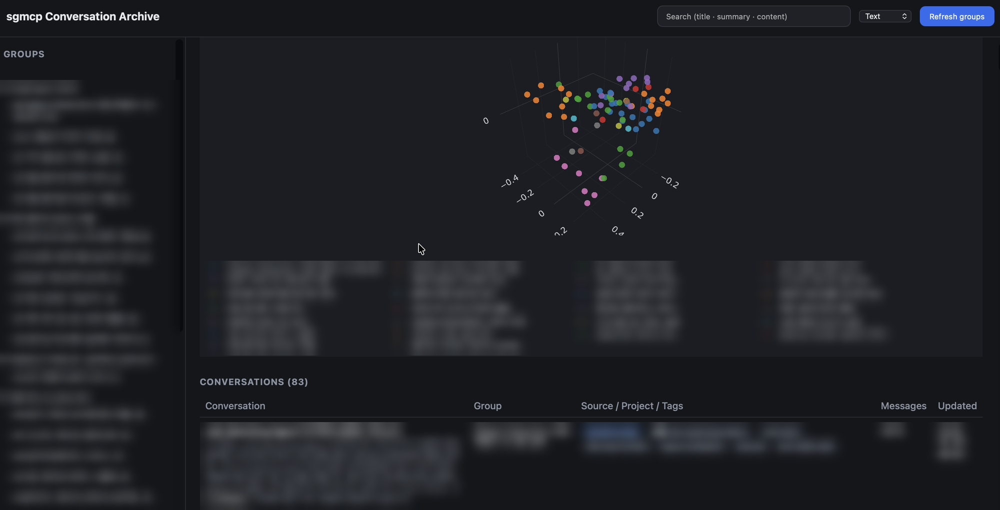

# sgmcp

A personal MCP server that gives my AI assistants a shared, long-term memory. It
collects my conversations from claude.ai, Claude Code and ChatGPT into one Postgres
database, and any of those assistants can look them up later.



## What This Does

My conversations with AI assistants were spread across several apps, and each
assistant knew only its own. sgmcp keeps them in one place and hands them back: an
assistant can search earlier conversations about my career, past decisions and other
projects, and answer with that history instead of starting from zero.

Each client sends the conversation text, unchanged, to the server. The server writes
the titles, tags, summaries and topic groups, and a dashboard lets me browse and search
the archive and see the groups on a 3D map.

## How It Works

- **Saving.** claude.ai (and ChatGPT, when connected) saves through MCP tools after
  every answer. Claude Code saves through a Stop hook that reads the local session
  transcript, so it spends no model tokens.
- **Recalling.** Any connected assistant can look up earlier conversations: by keyword
  with `search_conversations`, or by topic with `search_conversations_by_meaning` when
  it doesn't know the exact words. Results say where in a conversation the match
  sits, so `get_conversation` can open that stretch instead of the whole
  conversation: the summary first, the verbatim messages when it needs the details.
- **Reopening.** Each conversation keeps a way back to the app it came from. Claude
  Code stores a `cd <project> && claude --resume <session-id>` command, and claude.ai
  stores the chat URL, which the assistant asks the user to paste. The dashboard shows
  the URL as a link and the command with a copy button, and the archive tools return
  it too, so a conversation found later can be continued where it started. The resume
  command needs the session's local transcript, so it works on the machine that ran
  the session.
- **Storing.** One Postgres table holds the verbatim messages. Every other column is
  derived from them and can be rebuilt.
- **Deriving.** The dashboard's "Refresh groups" button embeds new messages and checks
  which conversations have drifted from their last summary. Only those get new titles,
  tags and summaries from the LLM; with no drift, a refresh makes no LLM calls.
  Clustering then groups conversations by topic, and PCA places them on the 3D map.
- **Searching.** Text search matches exact strings, such as an error message. Meaning
  search cuts each conversation into ~1,500-character passages and ranks a
  conversation by its best-matching passage. The server indexes new messages in the
  background right after each save; passages are cut in message order, so only the
  last passage and any new ones are embedded.

[ARCHITECTURE.md](ARCHITECTURE.md) has the diagrams, the data model and the
measurements behind each tuned value.

### MCP tools

| Tool | What it does |
|---|---|
| `save_conversation(messages, source?, project?, key?)` | Create a conversation (the server issues a `cw-`+UUID key when none is given), or overwrite one to repair it |
| `append_messages(key, new_messages, project?, source_url?)` | Append the latest turn; an identical resend is ignored. `source_url` stores the chat's address for reopening |
| `get_conversation(key, full=False, start?, count=20)` | Load one conversation, summary first. `full=true` adds the verbatim messages: a short conversation whole, a long one `count` messages from `start` (default: the most recent; `count=0` for no count limit), with `next_start`/`prev_start` to keep reading. A page never exceeds 20,000 characters |
| `list_conversations(limit)` | Recent conversations, without message bodies |
| `search_conversations(query, limit)` | Keyword search over title, summary and content; each result lists where the keyword occurs (`sections`, newest first) |
| `search_conversations_by_meaning(query, limit)` | Meaning search for a topic whose exact words are unknown; each result lists the stretches where it is discussed (`sections`). New messages become searchable seconds after they are saved |

## Tech Stack

- **Server**: Python with FastMCP over streamable HTTP, so claude.ai and Claude Code
  connect to it as a remote MCP server
- **Database**: Neon Postgres with pgvector, one store for the text, the vectors and
  the HNSW index behind meaning search
- **LLM**: OpenAI `text-embedding-3-small` for embeddings; `gpt-4.1-mini` through
  pydantic-ai for titles, tags and group names, with schema and language checks that
  retry on failure
- **Dashboard**: a single HTML page, with Plotly for the 3D map
- **Hosting**: Fly.io in Frankfurt, suspended when idle. Running costs: Fly under $2,
  Neon $0 and OpenAI a few dozen cents a month

## Getting Started

Requires [uv](https://docs.astral.sh/uv/).

```bash
uv sync                                                    # install dependencies
DATABASE_URL="postgresql://..." uv run python server.py    # serves on port 8000
```

Set `PORT` to use another port. The MCP endpoint is `http://localhost:8000/mcp`, and
the dashboard is at `http://localhost:8000/?token=<DASHBOARD_TOKEN>`. Smoke test:

```bash
curl -X POST http://localhost:8000/mcp \
  -H "Content-Type: application/json" \
  -H "Accept: application/json, text/event-stream" \
  -d '{"jsonrpc":"2.0","id":1,"method":"initialize","params":{"protocolVersion":"2025-03-26","capabilities":{},"clientInfo":{"name":"test","version":"0"}}}'
```

### Environment variables

| Variable | Purpose |
|---|---|
| `DATABASE_URL` | Postgres connection string (e.g. Neon). Needed by the archive tools and the dashboard |
| `DASHBOARD_TOKEN` | Dashboard access token. The dashboard is off when unset |
| `INGEST_TOKEN` | Auth token for `POST /api/ingest`, used by the Claude Code hook |
| `OPENAI_API_KEY` | Embeddings, meaning search and metadata generation. List and keyword search work without it |
| `ARCHIVE_LANGUAGE` | Language of all derived text: titles, tags, summaries, group names (default: Korean) |

### Connecting a client

Leave the trailing slash off the endpoint URL: `/mcp/` answers with a 307 redirect
and the connection fails.

- **Claude Code**: `claude mcp add --transport http sgmcp https://<your-app>.fly.dev/mcp`
- **claude.ai**: Settings → Connectors → Add custom connector → `https://<your-app>.fly.dev/mcp`
- **Claude Code auto-save**: register `hooks/save_conversation.py` as a global Stop
  hook and put `INGEST_TOKEN` in the local `.env`. It upserts the session through
  `/api/ingest` after every turn; run it with `--backfill` to push past sessions.

### Deploying

```bash
docker build -t sgmcp . && docker run -p 8000:8000 sgmcp   # local container
fly deploy --ha=false                                      # Fly.io; the schema migrates at startup
```

## What I Learned

- **Keep the verbatim text as the only truth.** I reset and recomputed every derived
  column several times during development and lost nothing, because the raw messages
  were never touched.
- **Geometry answers "are these similar?"; an LLM answers "what kind of thing is
  this?"** Grouping the big categories by geometry alone left 7 near-singleton groups.
- **Search passages, not averages.** On 66 queries with known answers, the right
  conversation came first 68% of the time with passages, 59% with single messages and
  48% with one average vector per conversation.
- **Weight by length.** With an equal-weighted mean, short meta remarks made up 37% of
  the characters but cast 53% of the vote, and misplaced a conversation.

## Future Ideas

- [ ] Authentication on the `/mcp` endpoint
- [ ] Split conversations that mix two topics, so each part lands in its own group
- [ ] "Conversations similar to this one", using the vector column that is already kept in sync
