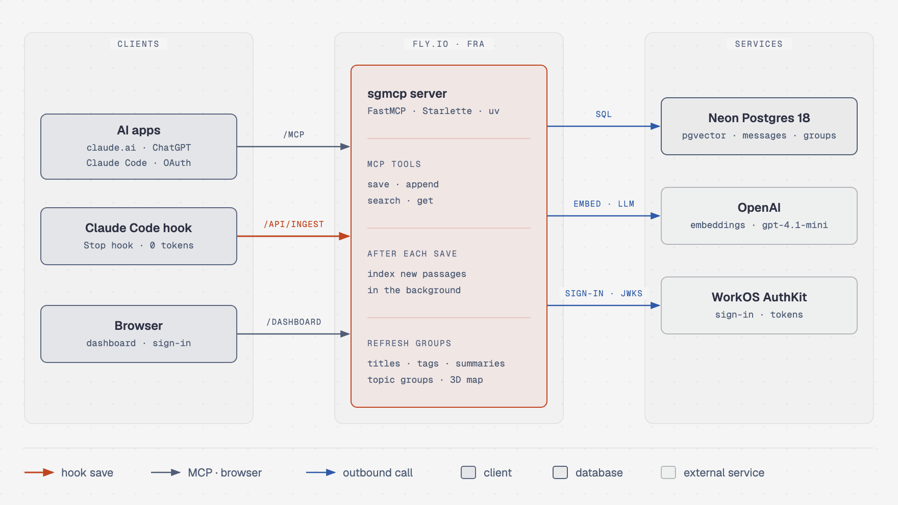
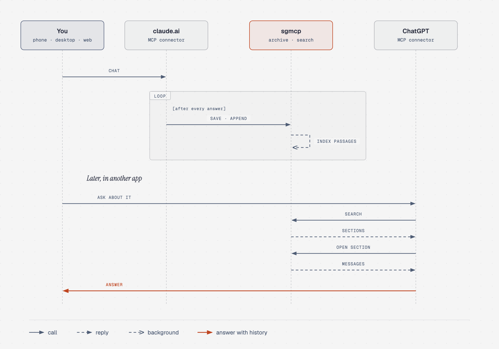
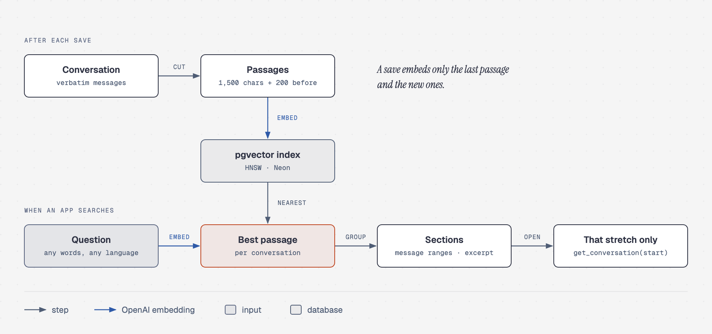
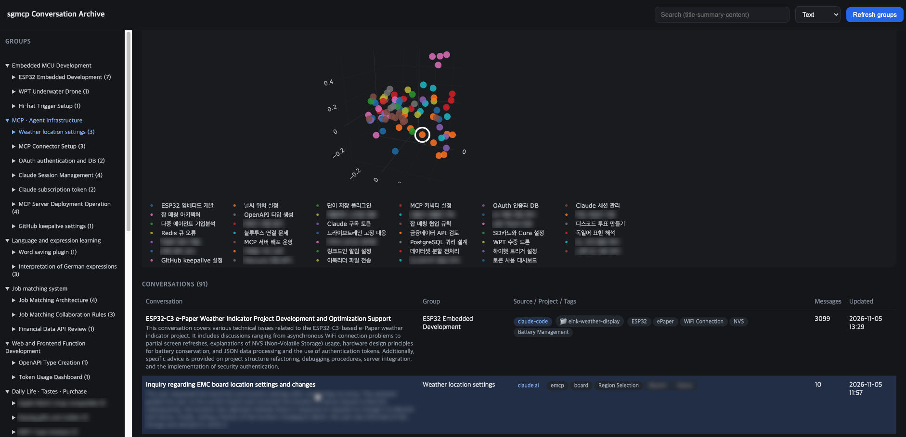

[English](README.md) | [한국어](docs/ko/README.md)

# sgmcp

sgmcp is a personal MCP server that gives your AI apps one shared memory. It saves your conversations from claude.ai, ChatGPT and Claude Code into one archive while you talk, and any of those apps can search the archive and read from it later.


<br>


<br>




## Features
| Feature | What it does |
|---|---|
| Saves on its own | claude.ai and ChatGPT save each turn through MCP tools right after they answer. Claude Code saves through a Stop hook that spends no model tokens |
| Recalls from any app | Ask ChatGPT about something you worked out in claude.ai or Claude Code. It searches the archive, by keyword or by meaning, and answers with that history |
| Opens the right spot | A search result points to the stretch of messages where the topic came up, so the app reads that part instead of the whole conversation |
| Back to the source | Each conversation keeps its claude.ai chat URL, or the `claude --resume` command of its Claude Code session |
| Dashboard | Titles, tags and summaries written by the server, topic groups on a 3D map, keyword and meaning search |
| Sign-in | WorkOS OAuth on `/mcp` and on the dashboard. Only members of one WorkOS organization get in |

## Save in one app, recall in another


| App | Saves | Recalls |
|---|---|---|
| claude.ai | `save_conversation` once, then `append_messages` after every answer, asked for by a few lines in its personal preferences | `search_conversations_by_meaning`, `search_conversations`, `get_conversation` |
| ChatGPT | the same tools through the sgmcp connector, asked for by the same lines in its instructions | the same tools |
| Claude Code | a global Stop hook posts the session transcript to `/api/ingest`: no model tokens, the text exactly as written | the same tools, after `claude mcp add` |

The lines to paste and the hook setup: [Setup § Auto-save](docs/en/setup.md#auto-save).

## How search finds the right stretch


- Keyword search matches exact strings, such as an error message or a function name.
- Meaning search finds a topic when you no longer remember the words, in any language. Each conversation is cut into 1,500-character passages, and it ranks by its best passage.
- Each result lists sections: where in the conversation the match sits, and when it was said. `get_conversation(start=…)` reads from there, a page of about 20,000 characters at a time.

## Dashboard


`/dashboard`, after a WorkOS sign-in:

- Topic groups under big categories, named by an LLM, and a 3D map of every conversation
- Keyword and meaning search, the conversation list, and a reading view with the link or resume command back to the source
- The Refresh groups button writes new titles, tags and summaries only for conversations whose content has moved on. When nothing has changed, it makes no LLM calls

## MCP tools
| Tool | Does |
|---|---|
| `save_conversation` | creates a conversation; the server issues its key |
| `append_messages` | adds the turns not saved yet |
| `get_conversation` | the summary first, then the verbatim messages a page at a time |
| `list_conversations` | recent conversations, without message bodies |
| `search_conversations` | keyword search, with the sections where the keyword occurs |
| `search_conversations_by_meaning` | meaning search, with the sections where the topic is discussed |

Arguments and paging: [MCP tools](docs/en/tools.md).

## Stack
| Area | Used | For |
|---|---|---|
| Server | Python 3.12, uv, MCP SDK 1.28 (FastMCP, streamable HTTP, stateless), Starlette | MCP tools, ingest API, dashboard |
| Database | Neon Postgres 18, pgvector 0.8 (HNSW), pg_trgm, psycopg 3 | messages, search passages, groups |
| AI | OpenAI `text-embedding-3-small`; `gpt-4.1-mini` and `gpt-5.4-mini` through pydantic-ai | embeddings; titles, tags, summaries, group names |
| Grouping | NumPy, SciPy | average-linkage clustering, 3D coordinates (PCA) |
| Sign-in | WorkOS AuthKit, PyJWT | OAuth on `/mcp`, dashboard sign-in |
| Dashboard | one HTML page, Plotly.js 2.35 | groups, 3D map, search |
| Hosting | Fly.io `fra`, shared-cpu-1x, 512 MB, suspended when idle | production server |

Running costs: Fly under $2, Neon $0 and OpenAI a few dozen cents a month.

## Quick start
```bash
uv sync
DATABASE_URL="postgresql://..." uv run python server.py   # MCP at http://localhost:8000/mcp
```

Environment variables, connecting each app, the Claude Code hook and deploying: [Setup](docs/en/setup.md).

## Docs
| Doc | About |
|---|---|
| [Setup](docs/en/setup.md) | running locally, environment variables, connecting apps, auto-save, the Claude Code hook, deploying |
| [MCP tools](docs/en/tools.md) | every tool, its arguments, sections and paging |
| [Evaluating search](docs/en/eval.md) | the eval branch, the two evals, baselines, the pre-push hook |
| [ARCHITECTURE.md](ARCHITECTURE.md) | save flows, the refresh pipeline, search internals, data model, measured values |

## What I learned
- **Keep the verbatim text as the only truth.** I reset and recomputed every derived column several times during development and lost nothing, because the raw messages were never touched.
- **Geometry answers "are these similar?"; an LLM answers "what kind of thing is this?"** Grouping the big categories by geometry alone left 7 near-singleton groups.
- **Search passages, not averages.** On 66 queries with known answers, the right conversation came first 68% of the time with passages, 59% with single messages and 48% with one average vector per conversation.
- **Weight by length.** With an equal-weighted mean, short meta remarks made up 37% of the characters but cast 53% of the vote, and misplaced a conversation.

## Future ideas
- [ ] Split conversations that mix two topics, so each part lands in its own group
- [ ] "Conversations similar to this one" on the dashboard, by running meaning search with the conversation's card
