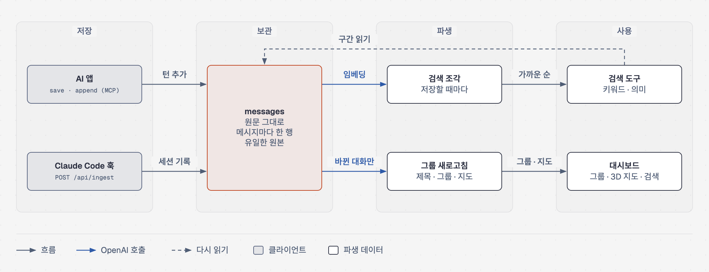
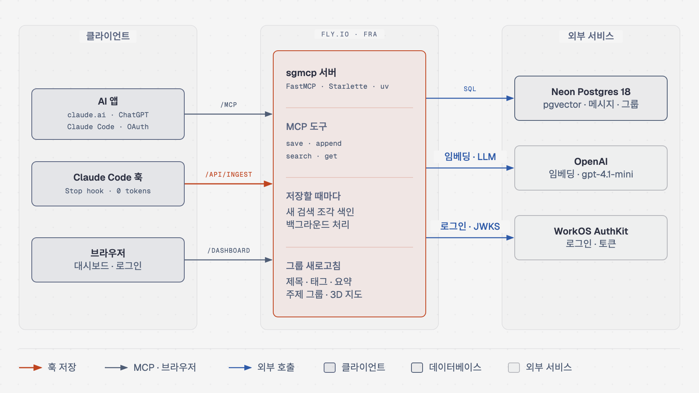
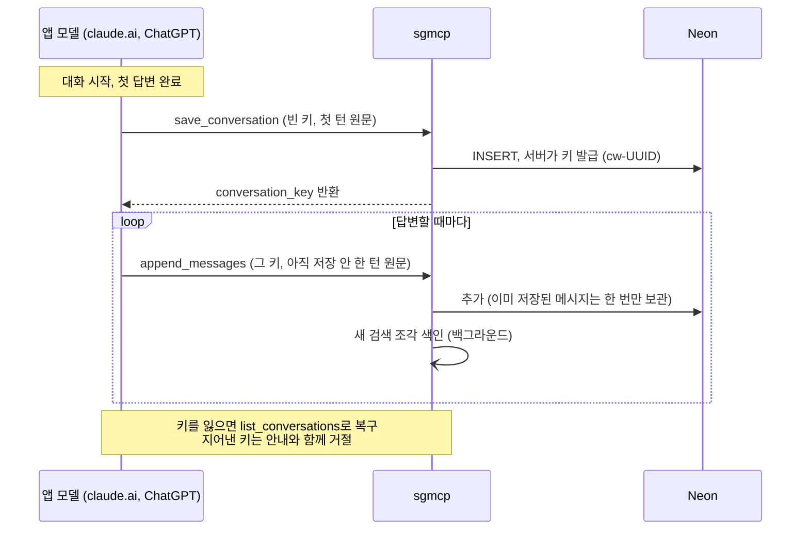
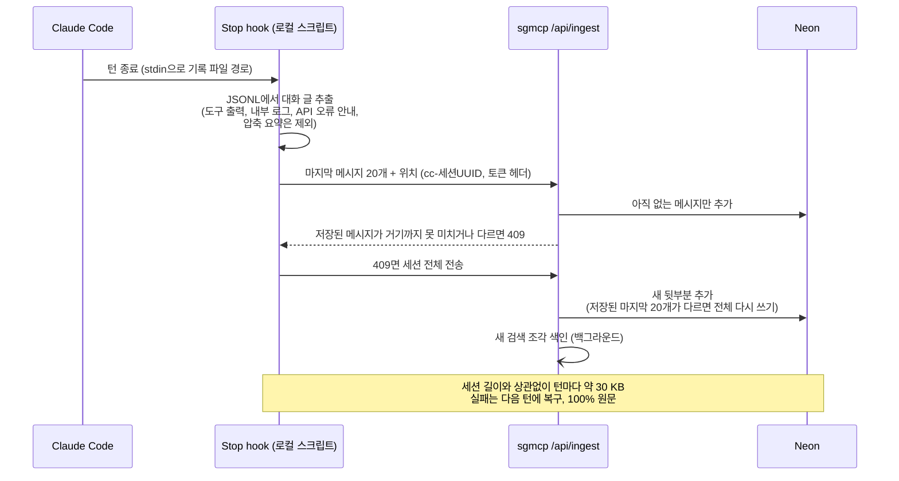
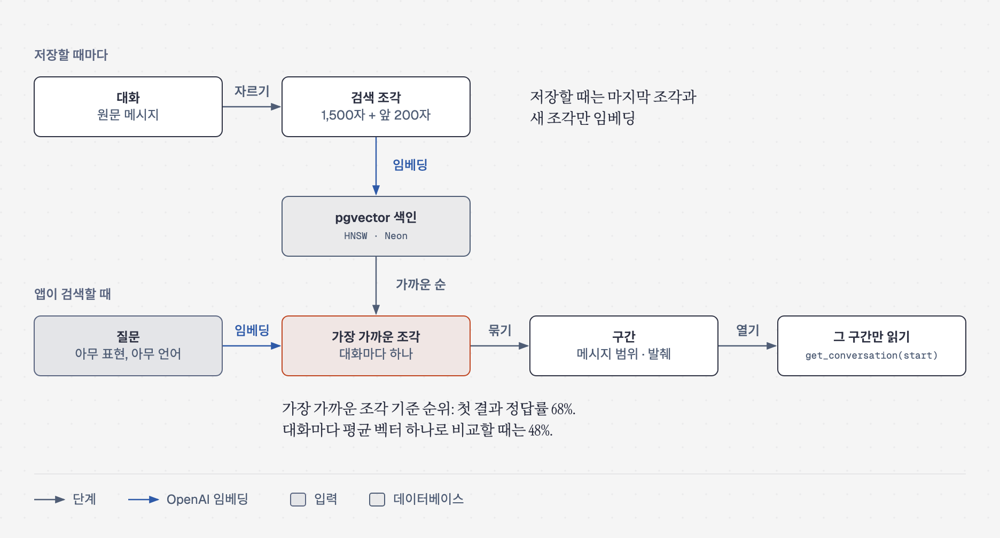
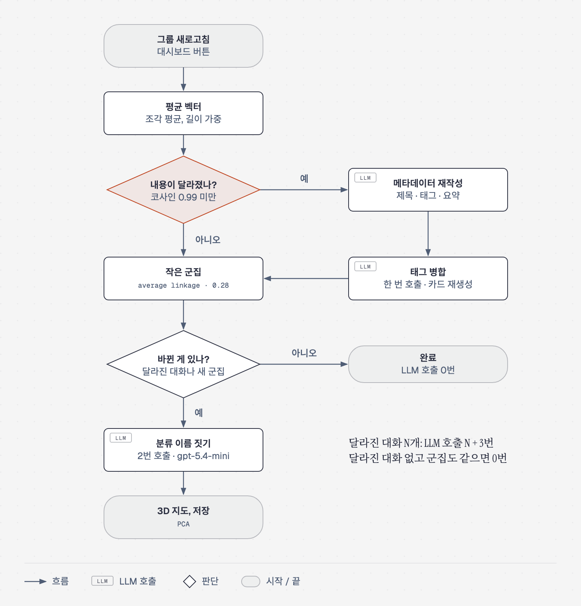
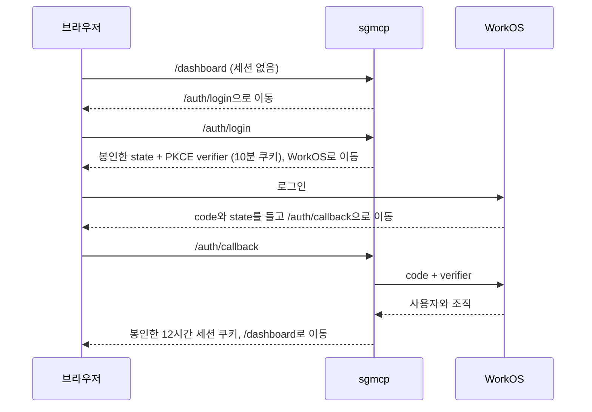

[English](../../ARCHITECTURE.md) | [한국어](ARCHITECTURE.md)

# sgmcp 구조

여러 AI 앱의 대화를 Postgres 보관함 하나에 모으고, 제목·태그·요약·주제 그룹을 만들어, 어느 앱에서든 검색으로 다시 꺼내 쓰게 하는 서버.

| 단계 | 하는 일 | 상세 |
|---|---|---|
| 저장 | 앱이 대화 글을 쓴 그대로 전송. claude.ai와 ChatGPT는 MCP 도구, Claude Code는 Stop hook | [저장](#저장) |
| 보관 | Postgres에 메시지마다 한 행. 다시 만들 수 없는 유일한 데이터 | [보관](#보관) |
| 파생 | 저장할 때마다 그 대화의 새 검색 조각 색인. Refresh groups 버튼은 바뀐 대화만 골라 제목, 태그, 요약, 그룹, 3D 지도 작성 | [검색 색인](#검색-색인), [그룹 새로고침](#그룹-새로고침) |
| 사용 | 검색 도구가 주제가 나온 구간을 돌려주고, `get_conversation`이 그 구간을 읽기. 대시보드에 그룹과 지도 표시 | [검색](#검색) |

## 구성 요소

| 구성 요소 | 역할 |
|---|---|
| 클라이언트 | 통로 역할만. 키와 함께 원문을 보낼 뿐 판단은 하지 않음 |
| 서버 | 저장할 때마다 그 대화의 새 검색 조각을 백그라운드에서 색인. 새로고침 때는 나머지 파생 작업 전부: 제목, 태그, 요약, 그룹, 좌표 |
| Neon | 유일한 저장소. 원본은 메시지뿐이고 나머지는 모두 다시 계산 가능 |
| OpenAI | 임베딩(`text-embedding-3-small`). pydantic-ai로 제목·태그·요약(`gpt-4.1-mini`)과 그룹 이름(`gpt-5.4-mini`) 생성. 형식·언어 검사에 실패하면 재시도 |
| WorkOS | `/mcp`와 대시보드 로그인. 조직 한 곳의 멤버인 것이 곧 승인 |

| 경로 | 사용처 | 인증 |
|---|---|---|
| `/mcp` | AI 앱 | WorkOS OAuth 액세스 토큰 |
| `/api/ingest` | Claude Code hook | `INGEST_TOKEN` |
| `/dashboard`, `/api/*` | 브라우저 | WorkOS 로그인, 12시간 세션 쿠키 |
| `/auth/login`, `/auth/callback` | 브라우저 | 로그인 과정 자체 |

## 저장

### claude.ai와 ChatGPT: 턴마다, 지침의 요청으로
앱의 모델이 상시 지침의 요청에 따라 저장 도구 호출([설정 § 자동 저장](setup.md#자동-저장)).

모델이 글을 다시 타이핑해서 보내므로 이 경로는 원문 그대로를 보장하지 못함. 앱에 원본 기록을 그대로 내보내는 통로가 없기 때문.

### Claude Code: 턴마다, hook으로, 모델 토큰 없이

## 보관

### 데이터 모델: 열의 세 층
| 층 | 열 | 작성 주체 |
|---|---|---|
| 원본 (불변) | `conversation_key` `source` `project`, 그리고 `messages(conversation_id, idx, role, content, at)`: 메시지마다 한 행, 대화의 `message_count` | 클라이언트 |
| 파생, LLM | `title` `tags`(중요도 순 배열) `summary` `tagged_embedding`(기준점) | 새로고침, 내용이 달라진 대화만 |
| 파생, 계산 | `embedding`(조각 평균, 길이 가중) `embedded_message_count` `cluster_small/big(_label)` `px py pz` | 새로고침 |
| 검색 색인 | `conversation_chunks(conversation_id, kind, chunk_index, vec, first_message, last_message)` + `chunked_message_count` `chunk_version` | 저장할 때마다(본문 조각, 백그라운드) · 새로고침(카드, 밀린 조각) |
| 사용 기록 | `recall_log(tool, args, result)`, 별도 표 | MCP 검색·읽기 도구 |

달라짐(drift)은 SQL에서 판정(`embedding <=> tagged_embedding`). 그래서 메타데이터 단계는 벡터를 메모리에 올리지 않고, 군집화와 3D 투영 때만 벡터를 불러옴.

### 메시지 시각
메시지마다 보낸 시각(`at`) 보관. Claude Code는 기록 파일의 시각, claude.ai와 ChatGPT는 저장이 도착한 시각(그래서 한 턴의 메시지는 같은 시각). 다시 쓰기를 해도 제자리에 남은 메시지는 시각 유지. 시각 기록 전에 저장된 메시지는 시각 없음. 단, 그 Claude Code 기록 파일이 아직 남아 있었다면 거기서 채움. Claude Code는 `cleanupPeriodDays`가 지나면 기록 파일 삭제.

## 검색 색인

대화마다 약 1,500자 조각들과 `제목 + 요약 + 태그` 카드 하나로 분할. 검색은 대화를 가장 잘 맞는 조각 하나로 평가. 대화 평균 벡터는 대화 전체가 무엇에 관한 것인지를 표현해서 군집화에는 맞지만 검색에는 너무 흐릿함. 질문 66개에서 첫 결과 정답률이 조각 68%, 평균 48%였고, 대화 하나가 상관없는 질문에도 1등으로 나오는 문제 발생([검색·그룹 평가](eval.md#측정으로-정한-것)).

**저장할 때마다 색인.** 저장 도구와 `/api/ingest`가 대화를 백그라운드 작업자 하나의 대기열에 넣음. 그래서 저장은 OpenAI를 기다리지 않고, 같은 대화를 두 저장이 동시에 색인하는 일도 없음. 조각은 메시지 순서대로 자르므로 메시지가 추가되면 마지막 조각만 바뀌거나 새 조각이 생길 뿐. 그 조각만 임베딩. 턴마다 조각 하나 정도이고, 가장 큰 대화를 처음부터 다시 만들면 약 천 개. 임베딩은 잠금 밖에서 실행하므로, 쓰기 전에 행을 잠그고 `chunked_message_count`가 시작할 때 값 그대로인지 확인. 새로고침이 먼저 썼다면 아무것도 쓰지 않음. 실패한 실행은 카운터를 뒤처진 채로 남기므로, 다음 저장이나 새로고침의 따라잡기 단계가 마무리. 줄어든 대화는 다시 쓰인 것이므로 처음부터 다시 색인.

**자르는 규칙.** 대화 글을 1,500자마다 자르되, 단어가 잘리지 않게 100자 안의 공백으로 당김. 메시지 경계에 맞추지 않음: 크기가 고르게 유지되고, 긴 메시지는 잘리지 않고 나뉨. 예전의 메시지 경계 규칙은 1,500자를 넘겨 메시지를 통째로 붙이고 조각을 6,000자로 제한해서 글의 11%를 검색할 수 없었음. 조각마다 앞 200자를 붙여 임베딩하되, 위치는 자기 글의 메시지만 가리킴. 그래서 자르는 지점에 걸친 문장이나 질문·답변이 약한 반쪽 둘이 아니라 하나로 점수를 받음. 규칙에는 버전(`CHUNK_VERSION`, 대화마다 `chunk_version`으로 저장)이 있어서 다른 버전으로 잘린 대화는 다음 색인 때 처음부터 다시 자름. 옛 조각과 새 조각이 섞이지 않음. 규칙을 바꾸려면 번호만 올리면 되고 나머지는 저장이나 새로고침이 처리.

**카드: 지우고 다시 만들기.** 카드의 입력 글을 바꾸는 작업(메타데이터 재생성, 태그 병합)은 같은 트랜잭션에서 카드 행을 지우고, 나중 단계가 빠진 카드를 모두 다시 생성. 빠진 카드는 다음 새로고침이 알아채므로 저절로 복구. 반면 조용히 낡은 카드는 복구되지 않음. 기준점이 이미 옮겨져서 달라짐 판정이 다시 걸리지 않기 때문.

## 검색
대시보드의 검색창 하나에 두 방식. 앱도 같은 두 방식을 MCP 도구로 사용.

| 방식 | 도구 | 동작 |
|---|---|---|
| 글자 | `search_conversations` | 제목, 요약, 원문 메시지에 `ILIKE`. 검색어의 `%`, `_`, `\`는 일반 문자로 취급. 오류 메시지처럼 정확한 문자열에 적합. 제목과 요약의 trigram 색인으로 전체 스캔 생략 |
| 의미 | `search_conversations_by_meaning` | 검색어를 임베딩하고, 대화마다 가장 가까운 조각의 코사인 거리로 순위. pgvector의 HNSW 색인 사용 |

**결과가 대화 안의 위치를 가리킴.** 조각마다 덮는 첫 메시지와 마지막 메시지를 저장. 그래서 의미 검색 결과는 가장 잘 맞는 조각들(최고 점수와 0.15 이내, 10조각 이내 간격)을 `sections`로 묶음: 메시지 범위, 가장 잘 맞는 메시지, 발췌. 키워드 결과도 키워드가 든 메시지로 같은 방식(20메시지 이내 간격이면 한 구간, 최신순, 오래된 구간도 목록에 포함). 구간마다 첫 메시지와 마지막 메시지를 보낸 시각(`start_at`, `end_at`) 표시. "어젯밤에 뭐 했지" 같은 질문이 맞는 구간을 찾는 근거. 구간 길이를 보면 지나가는 언급인지, 넘겨 가며 읽을 긴 논의인지 판단 가능.

**읽기.** `get_conversation`은 `start`부터, 없으면 가장 최근 메시지부터 거꾸로 한 페이지 읽기. DB가 글자 수가 20,000자에 이를 때까지 메시지를 담음. Claude Code의 도구 출력 한도 안의 크기라 그보다 짧은 대화는 한 번에 전체 반환. 한 페이지보다 긴 메시지 하나는 잘라서 `truncated` 표시.

MCP로 한 검색과 읽기는 모두 `recall_log`에 기록. 어시스턴트가 구간을 끝까지 읽는지, 첫 화면에서 멈추는지 확인하는 수단.

## 그룹 새로고침
저장마다 스스로 색인하는 검색 조각을 빼면, 대시보드 버튼이 유일한 파생 작업 시작점. 달라진 대화가 N개면 LLM 호출 **N + 3**번, 달라진 대화가 없고 군집이 지난번과 같으면 **0**번.

4~6단계는 달라진 대화가 하나 이상일 때만 실행.

| 단계 | 하는 일 | LLM 호출 |
|---|---|---|
| 1. 따라잡기 | 밀린 검색 조각 색인. 저장이 스스로 색인하므로 여기서는 실패한 실행 복구. 달라짐 판정 전에 실행 | 0 |
| 2. 평균 벡터 | 대화의 벡터 = 조각들의 평균, 조각마다 자기 길이로 가중. 임베딩 호출 없음. 조각이 그대로인 대화는 건너뜀 | 0 |
| 3. 달라짐 판정 | 기준점이 아직 없거나, 벡터와 기준점의 코사인이 0.99 미만이면 달라진 대화 | 0 |
| 4. 메타데이터 재작성 | 달라진 대화만 메시지 40개 표본으로 제목, 태그(중요도 순), 요약 새로 작성. 기준점을 현재 벡터로 옮기고 낡은 검색 카드 삭제 | 달라진 대화마다 1 |
| 5. 태그 병합 | 전체 태그를 한 번에 보고 같은 주제의 다른 표기 통일. 태그가 바뀐 대화도 카드 삭제 | 1 |
| 6. 카드 재생성 | 제목과 태그가 확정된 뒤 빠진 검색 카드 전부 다시 생성 | 0 (임베딩만) |
| 7. 작은 군집 | 새로고침마다 기하로 계산: 조각 평균 + 카드, 언어별 중심 맞추기, 코사인 0.28 기준 average linkage | 0 |
| 8. 분류 이름 짓기 | 달라진 대화가 있거나 군집이 저장된 것과 다를 때만. `gpt-5.4-mini`가 큰 분류를 약 5~15개 만들고(목표일 뿐 검사 안 함) 분류마다 담을 내용을 적은 뒤, 그룹마다 분류 하나를 정해진 보기 중에서 골라 이름 짓기. 실패하면 아무것도 저장하지 않아 다음 새로고침이 재시도 | 2 |
| 9. 3D 지도 | PCA로 좌표 계산 후 전부 저장 | 0 |

표본: 대화를 20구간으로 나누고 구간마다 가장 긴 사용자 메시지와 어시스턴트 메시지 선택. 최대 40개, 메시지마다 400자.

## 로그인

| 입구 | 검사 |
|---|---|
| `/mcp` | WorkOS AuthKit 액세스 토큰(JWT): JWKS의 RS256 서명, `iss` = `MCP_AUTH_ISSUER`, `aud` = `<PUBLIC_URL>/mcp`, `exp` 필수, `org_id` = `MCP_AUTH_ORG`. 토큰이 없거나 거절되면 보호 자원 메타데이터와 함께 401. 이 응답으로 앱의 OAuth 로그인 시작. JWT가 아닌 bearer 값(hook의 토큰)은 로그 없이 통과. `MCP_AUTH_ISSUER`가 없으면 `/mcp` 개방(로컬 개발용) |
| `/api/ingest` | `Authorization: Bearer <INGEST_TOKEN>`을 상수 시간 비교. 아니면 403 |
| 대시보드 | 위 그림처럼 WorkOS를 통한 OAuth authorization code + PKCE. 콜백에서 state를 봉인 쿠키와 대조하고, 사용자 조직을 `MCP_AUTH_ORG`와 대조. 세션 쿠키는 HttpOnly, SameSite=Lax, https에서는 Secure. 쿠키가 없으면 `/api/*`는 403 |

## 설계 원칙
1. **원문만이 유일한 기준.** 파생 값은 모두 지우고 다시 계산 가능(개발 중 여러 번 실제로 실행).
2. **전부 저장, 거르기는 파생 단계에서만.** 저장 시점에 버린 데이터는 되돌릴 수 없으므로 하지 않음.
3. **클라이언트는 통로.** 판단(제목, 태그, 그룹)은 모두 서버 몫. 모델의 지침 준수에 기대는 부분은 최소화.
4. **질문에 맞는 도구.** "비슷한가?"는 계산(기하), "같은 종류인가, 뭐라고 부를까?"는 LLM의 일.
5. **판단에 필요한 것만 보여 주기.** 판단 대상은 원문, 맥락은 요약, 상관없는 것은 제외.

## 측정값과 근거
검색·그룹 eval의 동작과 측정 내용 상세는 [검색·그룹 평가](eval.md) 참고.

| 값 | 근거 |
|---|---|
| 달라짐 기준 코사인 0.99 | 마지막 10% 증가 ≈ 0.999(건너뜀) / 두 배 증가 ≈ 0.983–0.989(실행) / 다른 주제 25% 유입 ≈ 0.980–0.995. 잘못 실행돼도 저렴한 호출 한 번 |
| 길이 가중 평균 | 단순 평균은 짧고 잦은 메시지를 과대 반영. 실제 사례: 메타 발언이 글자 수로는 37%인데 표는 53%를 차지해 대화 하나가 엉뚱한 그룹에 배치 |
| 언어별 중심 맞추기 | 전: 유사도 중앙값 0.714(한 덩어리). 후: 같은 주제 0.4–0.9, 다른 주제 음수 |
| 큰 분류 = LLM | "객체 인식과 멀티 에이전트는 둘 다 AI"는 분류 지식이지 기하가 아님. 기하로 묶은 버전은 거의 혼자인 그룹 7개로 실패 |
| 작은 군집: 평균 + 카드에 average linkage, 0.28 | 대화 87개를 LLM 두 번의 분류가 일치한 쌍(같이 155쌍, 나머지는 따로)으로 채점: F1 0.62, precision 0.78. 0.22~0.32 구간에서 0.58~0.62로 평탄. 이전의 평균만 쓰는 centroid linkage는 0.37: 커지는 군집의 흐릿한 중심이 이웃을 흡수해 16개짜리 덩어리 형성 |
| 분류 이름은 두 번 호출, `gpt-5.4-mini` | 한 번에 분류를 만들고 그룹까지 배치시키면 소프트웨어 프로젝트를 구직 분류에 배치. 두 번 호출(범위가 있는 분류, 다음에 정해진 보기 중 선택)로 그룹 36개를 분류하면 잘못 배치 4.1-mini ~6개, 5.4-mini ~5개, 5.5 ~3개, 재분류 한 번에 $0.01 / $0.02 / $0.18 |
| `ARCHIVE_LANGUAGE` | 파생 글 전체를 설정한 한 언어로 통일해 태그 어휘가 언어별로 갈라지지 않게 함. 출력 검사와 재시도로 강제 |
| 검색 조각 1,500자 | 정답이 있는 질문 66개의 첫 결과 정답률: 대화 평균 48%, 메시지 단위 59%, 조각 **68%**(실데이터 재측정 70%). 메시지 하나는 맥락 부족, 대화 전체는 서로 뭉개짐. 이 보관함 기준 조각 벡터 24 MB, 메시지 단위 약 65 MB |

## 운영
- **Secrets** (Fly): `DATABASE_URL` `INGEST_TOKEN` `OPENAI_API_KEY` `PUBLIC_URL` `MCP_AUTH_ISSUER` `MCP_AUTH_ORG` `WORKOS_CLIENT_ID` `WORKOS_API_KEY` `WORKOS_COOKIE_PASSWORD`. 로컬 `.env`: `INGEST_TOKEN`(hook용)
- **배포**: `fly deploy --ha=false`
- **스키마**: `db._SCHEMA`의 문장은 프로세스가 처음 DB에 연결할 때 실행. 실행한 문장은 `schema_migrations`에 기록하고 이후 건너뜀. `ALTER TABLE ... IF NOT EXISTS`는 더할 것이 없어도 표 전체를 잠가서, 매번 실행하면 시작할 때마다 긴 쓰기 작업 뒤에 줄을 서기 때문
- **비용**: 한 달에 Fly $2 미만(쓰지 않을 때 일시 정지) + Neon $0 + OpenAI 수십 센트

## 알려진 한계
- **접근은 전부 아니면 전무.** `/mcp`와 대시보드는 WorkOS 조직 한 곳의 멤버만 허용하고, 멤버는 보관함 전체를 봄. 대화에 아직 소유자 개념 없음. 대시보드 로그인은 12시간 유지라 멤버를 빼도 최대 그만큼 접근 가능
- claude.ai와 ChatGPT의 원문은 보장 불가. 모델이 다시 타이핑하고, 앱에 원본 기록 통로가 없음
- 두 주제가 섞인 대화는 두 그룹 사이에 위치. 나누기는 보류. 파생 값이라 나중에 추가 가능
- 바뀌지 않은 그룹은 다시 배치되지 않음. 오래되면 전체 재구성 사용
- 짧은 메시지(30자 미만)만 있는 대화는 임베딩이 없어 그룹과 지도에 나오지 않음
- 의미 검색은 eval 질문의 83%에서 첫 결과가 정답, 96%에서 상위 3개 안. 보관함에 없는 주제에도 그럴듯한 결과를 돌려줌: 그런 질문 10개 중 3개만 통과([현재 결과](eval.md#현재-결과))
