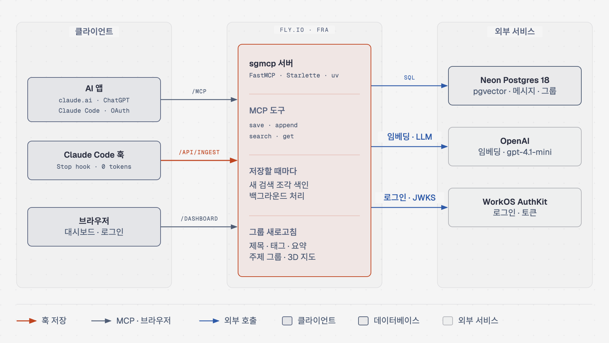
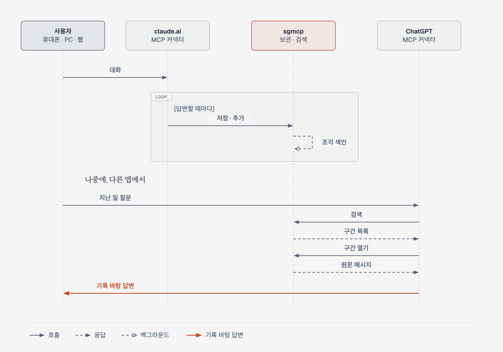
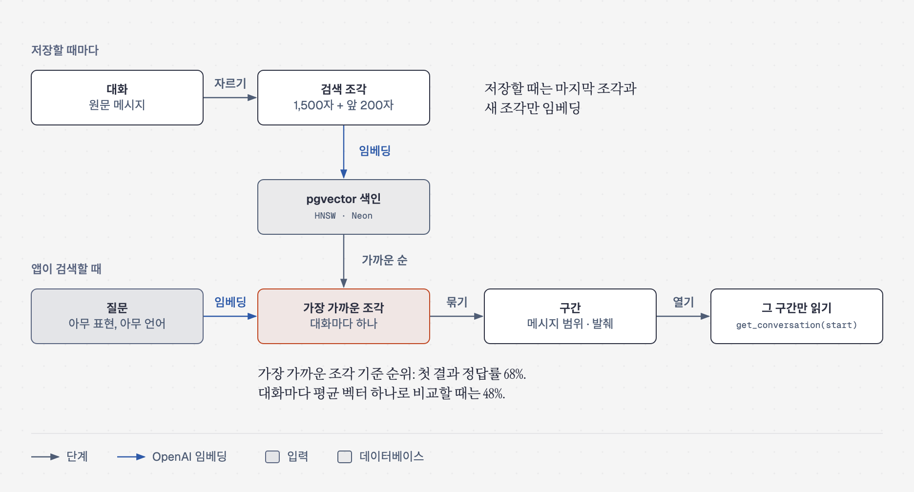
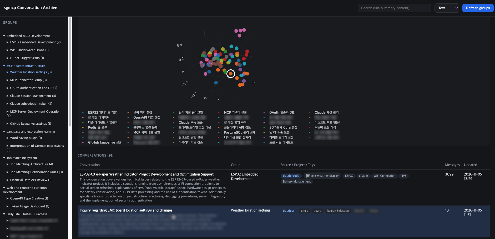

[English](../../README.md) | [한국어](README.md)

# sgmcp

여러 AI 앱이 하나의 기억을 함께 쓰게 하는 개인 MCP 서버. claude.ai, ChatGPT, Claude Code의 대화를 나누는 동안 한곳에 저장하고, 어느 앱에서든 다시 검색해 불러오기 가능.


<br>


<br>




## 주요 기능
| 기능 | 내용 |
|---|---|
| 자동 저장 | claude.ai와 ChatGPT는 답변 직후 MCP 도구로 턴마다 저장. Claude Code는 Stop hook으로 저장해 모델 토큰 사용 없음 |
| 어느 앱에서나 불러오기 | claude.ai나 Claude Code에서 정리한 내용을 ChatGPT에서 질문 가능. 키워드나 의미로 보관함을 검색해 그 기록을 바탕으로 답변 |
| 정확한 위치 | 검색 결과에 주제가 나온 메시지 구간까지 표시. 앱은 대화 전체 대신 그 구간만 읽기 |
| 원래 대화로 복귀 | 대화마다 claude.ai 채팅 주소나 Claude Code 세션의 `claude --resume` 명령 보관 |
| 대시보드 | 서버가 쓴 제목·태그·요약, 3D 지도 위 주제 그룹, 키워드 검색과 의미 검색 |
| 로그인 | `/mcp`와 대시보드 모두 WorkOS OAuth. WorkOS 조직 한 곳의 멤버만 접근 가능 |

## 한 앱에서 저장, 다른 앱에서 불러오기


| 앱 | 저장 | 불러오기 |
|---|---|---|
| claude.ai | 처음 한 번 `save_conversation`, 이후 답변마다 `append_messages`. 개인 설정(personal preferences)에 넣은 몇 줄로 요청 | `search_conversations_by_meaning`, `search_conversations`, `get_conversation` |
| ChatGPT | sgmcp 커넥터로 같은 도구 사용. 지침에 넣은 같은 몇 줄로 요청 | 같은 도구 |
| Claude Code | 전역 Stop hook이 세션 기록을 `/api/ingest`로 전송. 모델 토큰 사용 없음, 원문 그대로 저장 | `claude mcp add` 후 같은 도구 |

붙여 넣을 지침과 hook 설정은 [설정 § 자동 저장](setup.md#자동-저장) 참고.

## 검색이 맞는 구간을 찾는 과정


- 키워드 검색: 오류 메시지, 함수 이름처럼 정확한 문자열 일치
- 의미 검색: 표현이 기억나지 않을 때 주제로 찾기. 언어 무관. 대화를 1,500자 조각으로 나누고, 가장 가까운 조각 하나로 대화 순위 결정
- 결과마다 구간(sections) 포함: 대화 안에서 일치한 위치와 그 시각. `get_conversation(start=…)`로 그 지점부터 약 20,000자씩 읽기

## 대시보드


WorkOS 로그인 후 `/dashboard`:

- LLM이 이름 붙인 큰 분류 아래 주제 그룹, 전체 대화의 3D 지도
- 키워드·의미 검색, 대화 목록, 원래 대화로 가는 주소나 resume 명령이 있는 읽기 화면
- Refresh groups 버튼: 내용이 달라진 대화만 제목·태그·요약 새로 작성. 바뀐 것이 없으면 LLM 호출 없음

## MCP 도구
| 도구 | 기능 |
|---|---|
| `save_conversation` | 대화 생성. 키는 서버가 발급 |
| `append_messages` | 아직 저장하지 않은 턴 추가 |
| `get_conversation` | 요약 먼저, 이후 원문 메시지를 한 페이지씩 |
| `list_conversations` | 최근 대화 목록. 메시지 본문 제외 |
| `search_conversations` | 키워드 검색. 키워드가 나온 구간 포함 |
| `search_conversations_by_meaning` | 의미 검색. 주제를 다룬 구간 포함 |

인자와 페이지 넘김은 [MCP 도구](tools.md) 참고.

## 기술 스택
| 분야 | 사용 | 용도 |
|---|---|---|
| 서버 | Python 3.12, uv, MCP SDK 1.28 (FastMCP, streamable HTTP, stateless), Starlette | MCP 도구, ingest API, 대시보드 |
| 데이터베이스 | Neon Postgres 18, pgvector 0.8 (HNSW), pg_trgm, psycopg 3 | 메시지, 검색 조각, 그룹 |
| AI | OpenAI `text-embedding-3-small`, pydantic-ai로 호출하는 `gpt-4.1-mini`·`gpt-5.4-mini` | 임베딩, 제목·태그·요약·그룹 이름 |
| 그룹 묶기 | NumPy, SciPy | average linkage 군집화, 3D 좌표(PCA) |
| 로그인 | WorkOS AuthKit, PyJWT | `/mcp` OAuth, 대시보드 로그인 |
| 대시보드 | HTML 한 페이지, Plotly.js 2.35 | 그룹, 3D 지도, 검색 |
| 호스팅 | Fly.io `fra`, shared-cpu-1x, 512 MB, 쓰지 않을 때 일시 정지 | 운영 서버 |

운영 비용: 한 달에 Fly $2 미만, Neon $0, OpenAI 수십 센트.

## 빠른 시작
```bash
uv sync
DATABASE_URL="postgresql://..." uv run python server.py   # MCP 주소 http://localhost:8000/mcp
```

환경변수, 앱별 연결, Claude Code hook, 배포는 [설정](setup.md) 참고.

## 문서
| 문서 | 내용 |
|---|---|
| [설정](setup.md) | 로컬 실행, 환경변수, 앱 연결, 자동 저장, Claude Code hook, 배포 |
| [MCP 도구](tools.md) | 도구별 인자, 구간, 페이지 넘김 |
| [검색 평가](eval.md) | eval branch, 두 가지 eval, 기준선, pre-push hook |
| [ARCHITECTURE.md](../../ARCHITECTURE.md) (영어) | 저장 흐름, 그룹 새로고침 과정, 검색 내부 구조, 데이터 모델, 측정값 |

## 배운 점
- **원문만이 유일한 기준.** 개발 중 파생 열을 여러 번 초기화하고 다시 계산했지만 잃은 것 없음. 원문 메시지는 한 번도 건드리지 않았기 때문.
- **"비슷한가?"는 기하, "무슨 종류인가?"는 LLM의 몫.** 큰 분류를 기하만으로 묶었을 때 거의 혼자인 그룹 7개 발생.
- **평균이 아닌 조각 단위 검색.** 정답이 정해진 질문 66개에서 첫 결과 정답률: 조각 68%, 메시지 단위 59%, 대화마다 평균 벡터 하나 48%.
- **길이 가중 평균.** 단순 평균에서는 짧은 메타 발언이 글자 수로는 37%인데 표는 53%를 차지해, 대화 하나가 엉뚱한 그룹에 배치.

## 향후 계획
- [ ] 두 주제가 섞인 대화를 나눠 각 부분을 맞는 그룹에 배치
- [ ] 대시보드에 "이 대화와 비슷한 대화" 추가. 대화 카드로 의미 검색 실행
